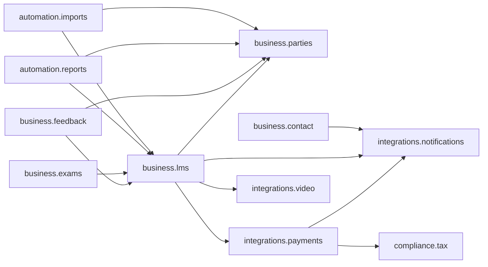

# Block catalogue

<!-- Generated by `uv run hulu-kernel catalogue` from the block manifests. Do not edit by hand. -->

What every block offers, needs, emits and consumes. To change an entry, edit the block's `manifest.yaml`.

## Blocks

| Block | Version | Status | Steward | Summary |
|---|---|---|---|---|
| `automation.imports` | 0.1.0 | proposed | platform-leads | CSV imports with a dry run and a row-by-row error report: students, bulk invitations, courses, data migration. |
| `automation.reports` | 0.1.0 | proposed | platform-leads | Revenue, enrolment and completion reports with CSV export, built from events; active learners per month. |
| `business.contact` | 0.1.0 | proposed | platform-leads | Contact form with spam limits and an admin inbox with unread count. |
| `business.exams` | 0.1.0 | proposed | platform-leads | Question banks, quizzes and exams with pass mark, attempt limits, server-enforced timer, explanations and results. |
| `business.feedback` | 0.1.0 | proposed | platform-leads | Ratings and written feedback on any subject by reference, with moderation and summaries. |
| `business.lms` | 0.1.0 | proposed | platform-leads | Courses, sections, lessons, enrolment, access policy, progress, announcements, discussion and the public catalogue. |
| `business.parties` | 0.1.0 | proposed | platform-leads | People and organisations with contact details and roles (student, teacher, staff); links a login to a business record. |
| `compliance.tax` | 0.1.0 | proposed | platform-leads | Tax rates and tax lines on fees and receipts; invoice registrar port with a manual adapter until e-invoicing rules exist. |
| `integrations.notifications` | 0.1.0 | proposed | platform-leads | Sends messages to people by email with templates per language; ready for SMS and Telegram adapters. |
| `integrations.payments` | 0.1.0 | proposed | platform-leads | Payment records and checkout for online and offline channels, with receipts and invoices; adapters for manual review and Chapa. |
| `integrations.video` | 0.1.0 | proposed | platform-leads | Upload, play tokens and allowed-domain checks for video hosts (Bunny, VdoCipher, external links). |

## Capabilities: who provides, who needs

| Capability | Provided by | Required by |
|---|---|---|
| `AccessQueryV1` | `business.lms` | `business.exams` |
| `AuditV1` | kernel | `automation.imports` `automation.reports` `business.contact` `business.exams` `business.feedback` `business.lms` `business.parties` `compliance.tax` `integrations.notifications` `integrations.payments` `integrations.video` |
| `CatalogQueryV1` | `business.lms` | `automation.reports` |
| `DocumentsV1` | kernel | `business.lms` `integrations.payments` |
| `EnrollmentPortV1` | `business.lms` | `automation.imports` |
| `ExamQueryV1` | `business.exams` | none |
| `FilesV1` | kernel | `business.lms` `integrations.payments` |
| `InvoiceRegistrarV1` | `compliance.tax` | none |
| `JobsV1` | kernel | `integrations.notifications` |
| `LocalizationV1` | kernel | `integrations.notifications` |
| `NotifierV1` | `integrations.notifications` | `business.contact` `business.lms` `integrations.payments` |
| `NumberingV1` | kernel | `business.lms` `integrations.payments` |
| `PartyPortV1` | `business.parties` | `automation.imports` |
| `PartyQueryV1` | `business.parties` | `automation.reports` `business.feedback` `business.lms` |
| `PaymentProviderV1` | `integrations.payments` | `business.lms` |
| `RatingQueryV1` | `business.feedback` | none |
| `ReviewEligibilityQueryV1` | `business.lms` | `business.feedback` |
| `SearchV1` | kernel | `business.lms` |
| `SettingsV1` | kernel | `compliance.tax` |
| `TaxServiceV1` | `compliance.tax` | `integrations.payments` |
| `VideoProviderV1` | `integrations.video` | `business.lms` |

## Events

| Event | Emitted by | Consumed by |
|---|---|---|
| `account.erased@1` | kernel or not yet built | `business.exams` `business.feedback` `business.lms` `business.parties` `integrations.payments` |
| `certificate.issued@1` | `business.lms` | none |
| `course.completed@1` | `business.lms` | `automation.reports` |
| `enrollment.activated@1` | `business.lms` | `automation.reports` |
| `exam.attempted@1` | `business.exams` | none |
| `exam.passed@1` | `business.exams` | `business.lms` |
| `import.completed@1` | `automation.imports` | none |
| `lesson.completed@1` | `business.lms` | none |
| `message.received@1` | `business.contact` | none |
| `party.created@1` | `business.parties` | none |
| `party.erased@1` | `business.parties` | none |
| `payment.confirmed@1` | `integrations.payments` | `automation.reports` `business.lms` |
| `payment.refunded@1` | `integrations.payments` | none |
| `review.hidden@1` | `business.feedback` | none |
| `review.submitted@1` | `business.feedback` | `business.lms` |

## Permissions

| Block | Permissions |
|---|---|
| `automation.imports` | `imports.job.run` `imports.job.view` |
| `automation.reports` | `reports.revenue.view` `reports.students.view` `reports.export.run` |
| `business.contact` | `contact.message.view` `contact.message.manage` |
| `business.exams` | `exams.exam.edit` `exams.attempt.view` `exams.result.export` |
| `business.feedback` | `feedback.review.submit` `feedback.review.moderate` |
| `business.lms` | `lms.course.view` `lms.course.edit` `lms.course.publish` `lms.lesson.edit` `lms.lesson.lock` `lms.enrollment.manage` `lms.announcement.edit` `lms.discussion.moderate` `lms.certificate.view` |
| `business.parties` | `parties.party.view` `parties.party.edit` `parties.contact.view` |
| `compliance.tax` | `tax.rate.edit` `tax.invoice.view` |
| `integrations.notifications` | `notifications.template.edit` `notifications.log.view` |
| `integrations.payments` | `payments.payment.view` `payments.payment.approve` `payments.payment.record` `payments.receipt.view` |
| `integrations.video` | `video.asset.upload` `video.asset.view` |

## Dependency graph

