# KPA-04 — UI/UX Design & Screen Specification

**Kasina Pastry Academy online learning platform** · Version 1.2 (Markdown) · 26 November 2026 · Built by Hulu Software Labs PLC

KPA-04 is the **master product specification**. KPA-01 (SRS) formalizes it, KPA-02 (Architecture) implements it, and `FRONTEND_BRIEF.md` and `BUILD_PLAN.md` sequence the work. KPA-03 is intentionally excluded.

## How to read this file

- **[v1.3: D-08] For frontend UI/UX, the PDF `source/KPA-04_UI_UX_Design_v1.1.pdf` governs, not this file or the pictures.** This conversion is shorter than the PDF and may have lost detail; check the PDF page for every screen you build. Owner decisions D-03, D-04 and D-07 still apply where the PDF predates them (see K-14).

- This Markdown is a complete conversion of *KPA-04 UI/UX Design v1.1* (116-page PDF). Each screen keeps its ID, its rules, and the desktop and mobile control lists. The PDF is kept in `docs/source/` for reference only.
- v1.2 changes are owner decisions recorded in `DECISIONS.md`. Each changed sentence is tagged `[v1.2: D-xx]`. Nothing else was altered.
- Each screen links to a picture in `docs/screens/<ID>.png`. The pictures are **static reconstructions**, not screenshots of a working application. Sample names, numbers, photos and language selection in them are illustrative. **Where a picture and the text differ, the text governs.** For example, the INS-004 and ADM-020 pictures still show "Additional authentication", which v1.2 removes.
- Layout and controls lists are a flattened record of what each screen shows, in reading order; " / " separates items. Do not infer controls that are not listed or shown.
- "Validation / configuration" notes are **open items, not permission to invent features**. Implement a configurable default where the text proposes one, and list the item in the README's unresolved decisions.
- Sample data in the control lists (Hana Tesfaye, ETB 3,500, 65%) are fixtures for mocks and demos, not requirements.

## Screen index

| ID | Screen | Portal | Phase |
| --- | --- | --- | --- |
| PUB-001 | Brand and shared layout | Public website | 1 |
| PUB-002 | Homepage — public | Public website | 1 |
| PUB-003 | Social media, header and footer | Public website | 1 |
| PUB-004 | Course catalog / Explore | Public website | 1 |
| PUB-005 | Course details and free preview | Public website | 1 |
| PUB-006 | About Kasina | Public website | 1 |
| AUTH-001 | Sign in, register and OTP | All | 1 |
| AUTH-002 | Portal selection and switching | All | 1 |
| STU-001 | Student — My Learning | Student | 1 |
| STU-002 | Student — Explore | Student | 1 |
| STU-003 | Enrollment and payment | Student | 1 |
| STU-004 | Payment status | Student | 1 |
| STU-005 | Course learning interface | Student | 1 |
| STU-006 | Assessments — consolidated view | Student | 1 |
| STU-007 | Quiz and results | Student | 1 |
| STU-008 | Practical assessment and submission | Student | 1 |
| STU-009 | Practical review status | Student | 1 |
| STU-010 | Certificates | Student | 1 |
| STU-011 | Account, history, notifications and support | Student | 1 |
| ACD-001 | Shared editor — details | Instructor + Admin | 1 |
| ACD-002 | Curriculum | Instructor + Admin | 1 |
| ACD-003 | Unified lesson editor | Instructor + Admin | 1 |
| ACD-004 | Lesson video states | Instructor + Admin | 1 |
| ACD-005 | Quiz editor | Instructor + Admin | 1 |
| ACD-006 | Practical assessment editor | Instructor + Admin | 1 |
| ACD-007 | Assessments overview | Instructor + Admin | 1 |
| ACD-008 | Practical submission review | Instructor + Admin | 1 |
| ACD-009 | Quiz results and course assessments | Instructor + Admin | 1 |
| ACD-010 | Individual academic record | Instructor + Admin | 1 |
| ACD-011 | Course announcements | Instructor + Admin | 1 |
| INS-001 | Instructor Dashboard | Instructor | 1 |
| INS-002 | My courses | Instructor | 1 |
| INS-003 | My students | Instructor | 1 |
| INS-004 | My profile | Instructor | 1 |
| ADM-001 | Admin dashboard | Admin | 1 |
| ADM-002 | Manage courses | Admin | 1 |
| ADM-003 | Manage staff | Admin | 1 |
| ADM-004 | Manage students | Admin | 1 |
| ADM-005 | Enrollment management | Admin | 1 |
| ADM-006 | Payments | Admin | 1 |
| ADM-007 | Certificates | Admin | 1 |
| ADM-008 | Financial reports | Admin | 1 |
| ADM-009 | Academic & enrollment reports | Admin | 1 |
| ADM-010 | Messages inbox | Admin | 1 |
| ADM-011 | Message conversation | Admin | 1 |
| ADM-012 | Contact Kasina | Admin | 1 |
| ADM-013 | Settings home | Admin | 1 |
| ADM-014 | Academy information | Admin | 1 |
| ADM-015 | Website content | Admin | 1 |
| ADM-016 | Homepage content editor | Admin | 1 |
| ADM-017 | Payment settings | Admin | 1 |
| ADM-018 | Learning settings | Admin | 1 |
| ADM-019 | Notifications | Admin | 1 |
| ADM-020 | Security & activity | Admin | 1 |
| TG-001 | Learn at Kasina — Telegram | Student (Telegram) | 2 |

## Shared rules and permissions

### Identity and authorization

One identity, three portals; student self-registration only. Admin all management; instructor assigned courses and their academic records only; student own enrollments, payments, certificates and conversations. Staff may learn as students only with valid enrollment. Server enforces scope on every request. Admin alone creates courses, sets commercial terms, assigns staff, publishes catalog, manages access, confirms payments, manages certificates, reports, messages and settings.

### Academic lifecycle

Three activity types. Required activities equally weighted; optional excluded. 90% unique video coverage or explicit completion for non-video lessons; quiz/practical pass. No locks. New required activities affect incomplete enrollments only; completed records and certificates remain valid. Reorder and text edits preserve progress. Video replacement preserves earned completion but resets incomplete playback coverage. Quiz edits preserve valid passes and historical attempts; archive rather than delete. Warn before adding requirements.

### Financial lifecycle

ETB minor units; verified receipt date in Africa/Addis_Ababa local calendar, Gregorian date display baseline. Revenue insight = confirmed valid payments by verified receipt date. No gross/net framework or accounting ledger. Pending/rejected excluded. New enrollment counted at first activation, renewal separately. Early renewal extends existing expiry, late renewal starts at confirmation. Admin cash self-confirmation allowed with audit and owner reconciliation. Refunds only under approved legal policy; do not silently edit confirmed records.

### Reporting definitions

Two tabs: Financial and Academic & enrollments. Academic cohort selected by first activation date; completion numerator and denominator same cohort, measured as of report generation. Unique students distinct identities; access active/expired/suspended independent of academic status. Certificates counted for eligible completed cohort. CSV follows filters and grouping.

### Security and retention

Session revocation; audit actor/time/old/new/reason. Sensitive bank-account changes require a fresh SMS OTP (step-up) and are audited, and an SMS and in-app alert goes to the administrator's verified phone. [v1.2: D-03, D-04 — no staff MFA in Phase 1; one administrator is sufficient] No audit editing. Private practical files; retention period must be approved before launch. No public certificate verification or automatic national qualification.

### Shared UI states

Every list has loading, empty, filtered empty, error/retry; every form has validation, saving, success, failure and unsaved warning. Uploads show progress, processing, retry; player handles unavailable and interrupted connection. Access denied and expired session preserve safe return route. Keyboard focus, contrast, labels, touch targets and screen-reader checks required.

### Additional agreed safeguards

Require at least one required activity before catalog publication. Archived required activities leave current requirements but retain history. Preserve earned completion on video replacement; reset incomplete playback coverage. Renewal uses purchased duration. Prevent duplicate open purchase requests; honor valid quoted price. Course type changes after enrollment require controlled migration. Disable staff with session revocation; prevent disabling last active administrator. Message read state per administrator; resolution shared. Timely practical submissions may be reviewed after expiry and earn completion/certificate; new attempts require active access.

## Public website

### PUB-001 — Brand and shared layout

Source: KPA-04 v1.1 pages 5–6. Visual reference: 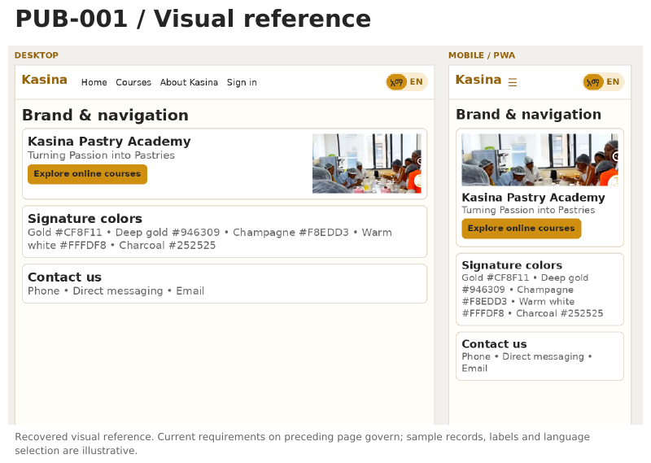

**Behavior and requirements**

Official display name Kasina Pastry Academy; slogan Turning Passion into Pastries. Existing circular logo, no rebranding. Physical academy expanding online; primarily learning and management, also official digital presence. No retail ordering. Palette: #CF8F11 gold, #946309 deep gold, #F8EDD3 champagne, #FFFDF8 warm white, #FFFFFF surfaces, #252525 charcoal. Approximate 75/15/10 balance. Gold buttons dark text; deep gold links; no gradients. English marketing headings Playfair Display; UI Inter; Amharic Noto Sans Ethiopic; Lucide icons. Shared tokens. Signature gold pill አማ / EN, default Amharic, persist preference and preserve current page; teaching language independent. Mobile-first; proposed breakpoints 640/1024/1440, test 360px Android, slow networks, WCAG 2.2 AA target. Public photography, student calm, instructor light, admin charcoal. Use shared tokens, 640/1024/1440 breakpoints and 360px minimum test viewport. Gold pill at far right; preserve route and unsaved state. Native Amharic review and WCAG testing are release gates.

**Validation / configuration (open, do not invent):** Original logo, photos and native Amharic copy needed. Colors sampled from screenshot; exact brand guide not supplied.

**Desktop layout and controls**

Charcoal social bar: slogan TikTok · Instagram · Telegram Logo · Home · Courses · About Kasina ▾ · Sign in · language Warm white canvas / champagne sections / gold actions Footer: brand · Explore · Contact us

**Mobile / PWA layout and controls**

Logo · hamburger · አማ / EN No social top bar Content stacked Contact footer

### PUB-002 — Homepage — public

Source: KPA-04 v1.1 pages 7–8. Visual reference: 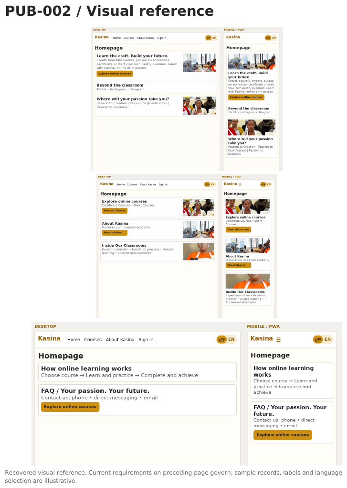

**Behavior and requirements**

Hero eyebrow TURNING PASSION INTO PASTRIES; headline Learn the craft. Build your future. Copy: Create beautiful sweets, pursue an accredited certificate or start your own pastry business. Learn with Kasina, online or in person. CTA Explore online courses; secondary Discover our in-person academy; mobile returning student sign-in link. Motivations: ONE PASSION. THREE POSSIBILITIES. Where will your passion take you? Passion to Creation — Turn your love for cakes and sweets into beautiful creations. Passion to Qualification — Develop professional skills and work towards an accredited certificate. Passion to Business — Turn your talent into income and build your own pastry business. Inside Our Classrooms: FROM KNOWLEDGE TO PRACTICAL SKILLS. Discover how our instructors turn knowledge into practical skills, guiding students from their first lesson to their own creations. Expert instruction, Hands-on practice, Guided learning, Student achievements. Teaching not commercial production. How it works: choose course, learn and practice, complete and achieve. No carousel, autoplay, popups, fake statistics or generic homepage builder.

**Validation / configuration (open, do not invent):** Accreditation wording must be verified; FAQ content and actual photos pending.

**Desktop layout and controls**

Social bar + standard header Hero: text left / classroom photo right Community social strip Three motivation cards Explore online courses About Kasina: photo + text Inside Our Classrooms: four photos How online learning works FAQ / Your passion. Your future. Traditional footer

**Mobile / PWA layout and controls**

Header Classroom photo Hero copy + CTAs Social strip Three compact image/text cards Course cards About Kasina Classroom gallery 2 × 2 How it works / FAQ / CTA Footer

### PUB-003 — Social media, header and footer

Source: KPA-04 v1.1 pages 9–10. Visual reference: 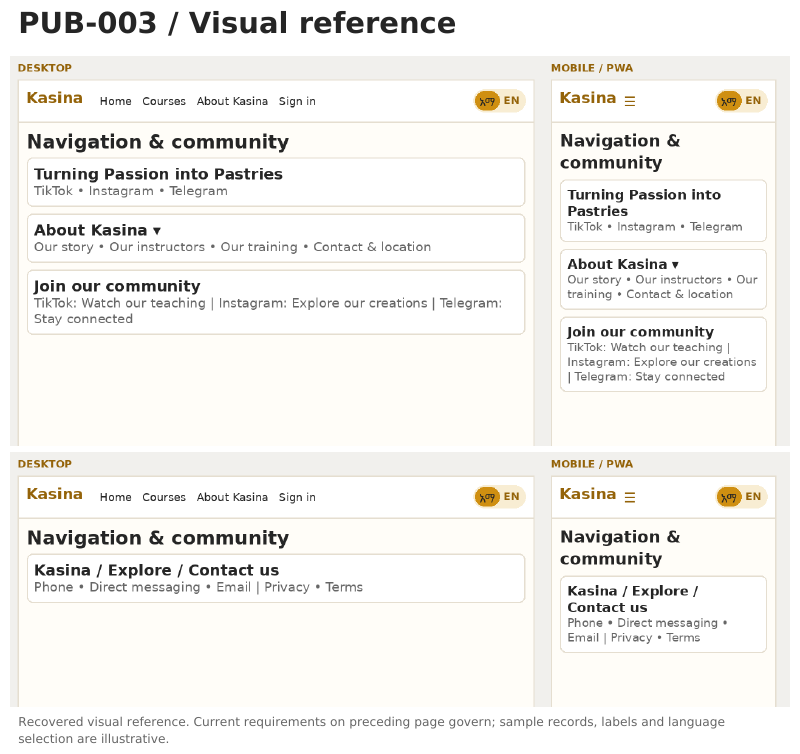

**Behavior and requirements**

Social media is integral to homepage and About Kasina, not footer. TikTok discovery, Instagram inspiration, Telegram public channel updates. Use lightweight thumbnails and links; no live feeds, follower API, autoplay or social publishing. Known TikTok: https://www.tiktok.com/@kasina.sweets. Public Telegram channel distinct from Learn at Kasina bot and Mini App. Social and contact settings separate. About dropdown anchored contact, story, instructors and training; mobile one About entry. Footer traditional contact only, warm charcoal and gold, no social links. Physical address on About.

**Validation / configuration (open, do not invent):** Instagram, Telegram channel, official contact numbers/email and direct messaging URL to confirm. Proposed editable selected promotional posts.

**Desktop layout and controls**

Top bar: Turning Passion into Pastries · social links Logo Home Courses About Kasina ▾ Sign in · አማ / EN Hero → gold community strip: TikTok / Instagram / Telegram Footer: Kasina / Explore / Contact us Copyright · Privacy · Terms

**Mobile / PWA layout and controls**

Kasina አማ EN Social media, header and footer Logo · menu · አማ / EN Menu: Home / Courses / About Kasina / Sign in Social strip directly below hero Footer: phone / direct message / email

### PUB-004 — Course catalog / Explore

Source: KPA-04 v1.1 pages 11–12. Visual reference: 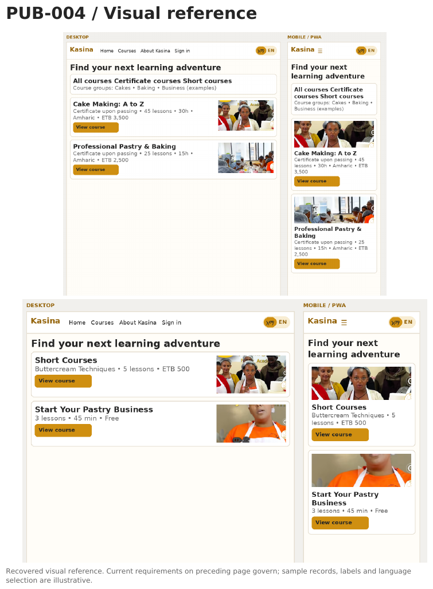

**Behavior and requirements**

Fixed types Certificate Courses and Short Courses; dynamic reusable Course Groups independent of type, multiple per course. Admin creates new group by typing and reuses it later; bilingual labels; central management. Public clickable filters, hide empty groups. Cards: thumbnail, name, optional short description, lesson count, duration, teaching language, price/free, View course. Certificate upon passing only for certificate type. No ratings, student counts, countdowns, instructor portraits or curriculum on cards. Homepage adaptive catalog: 1 featured, 2–3 all, 4–6 compact, >6 selected/View all, zero coming soon; hide empty groups. No large search until needed. Explore is identical to public catalog/details, no personalized badges, progress or recommendations. Surrounding navigation differs.

**Validation / configuration (open, do not invent):** Group rename/merge/reorder/archive details to validate for admin review.

**Desktop layout and controls**

Header / Find your next learning adventure All courses · Certificate courses · Short courses Dynamic course group chips Certificate Courses: large image cards in 2–3 columns Short Courses: compact horizontal cards In-person training invitation / footer

**Mobile / PWA layout and controls**

Explore our courses Type filters / group chips Certificate cards stacked Short cards compact horizontal Public footer or student navigation

### PUB-005 — Course details and free preview

Source: KPA-04 v1.1 pages 13–14. Visual reference: 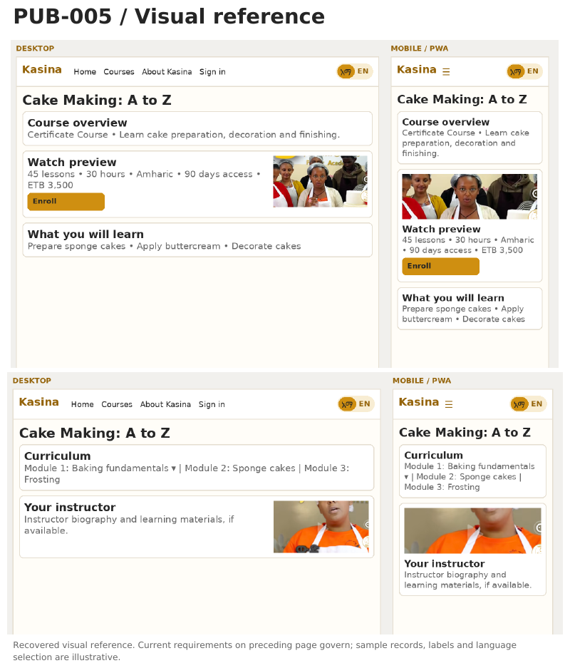

**Behavior and requirements**

One adaptive template for structured and short courses. Modules optional, materials/quizzes/practicals optional. Course teaching language independent of UI. Display configured access duration, shareable permanent URL and social metadata. Free courses and designated previews publicly accessible without login. Preview uses designated existing lessons; no mandatory promotional video. Anonymous watching creates no enrollment or personal watermark. Free course optional enrollment for progress: Start watching / Enroll for free. Paid: Enroll / Watch preview if available. Public pages never personalize enrollment or progress. Enroll routes to sign in/register with selected course retained; authenticated users bypass sign-in. Backend prevents duplicate active purchase. No empty sections, ratings, reviews or countdowns.

**Validation / configuration (open, do not invent):** Sticky mobile action and related course suggestions are to validate layout details.

**Desktop layout and controls**

Course title / description / outcomes Sticky enrollment panel Curriculum: expandable modules or flat lessons Thumbnail / preview / price / access Instructor / optional materials and assessments Enroll Certificate information only when applicable Related courses optional

**Mobile / PWA layout and controls**

Kasina አማ EN Course details and free preview Thumbnail / preview Title / price / description Outcomes / curriculum Instructor / optional sections Sticky price + Enroll

### PUB-006 — About Kasina

Source: KPA-04 v1.1 pages 15–16. Visual reference: 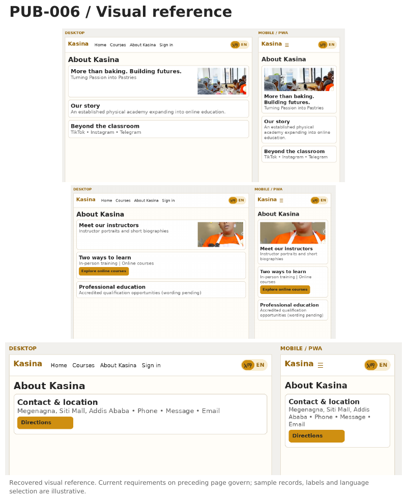

**Behavior and requirements**

One page with anchored dropdown shortcuts Our story, Our instructors, Our training, Contact & location. Social section immediately after story, champagne background: Watch our teaching / Explore our creations / Stay connected. Physical academy: Megenagna, Siti Mall, Addis Ababa, Ethiopia. Contact for in-person inquiries; no physical enrollment scheduling or attendance management in initial scope. No cake retail. Accredited certificate opportunities emphasized, testing center mentioned only as relevant credentials; online completion does not automatically confer national qualification. No separate instructor profile pages, booking or corporate essays.

**Validation / configuration (open, do not invent):** Actual history, instructor bios, accreditation details, address/contact confirmation and photos needed.

**Desktop layout and controls**

Hero: More than baking. Building futures. / classroom photo Our story Beyond the classroom: TikTok / Instagram / Telegram Meet our instructors Two ways to learn: in person / online Professional education and qualification opportunities Contact & location / footer

**Mobile / PWA layout and controls**

Hero photo + text Our story Social links prominent Instructor cards In-person / online Credentials Contact and location

## Authentication and portals

### AUTH-001 — Sign in, register and OTP

Source: KPA-04 v1.1 pages 17–18. Visual reference: 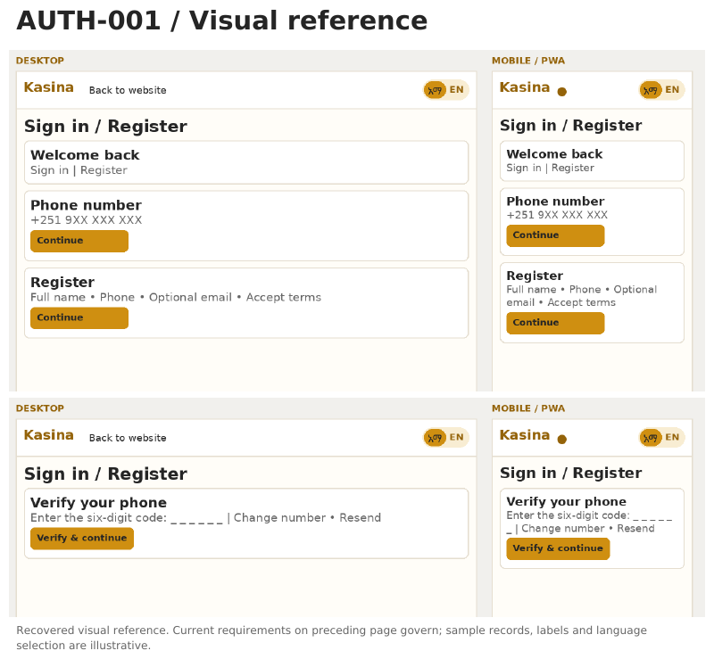

**Behavior and requirements**

One common public login, no role selection before authentication. Public registration creates student only; staff explicitly provisioned. No student password. Preserve selected course through authentication. No full marketing navigation or social links on authentication screen. Staff sign in with the same phone + SMS OTP as students; no TOTP, recovery codes or MFA screens in Phase 1 [v1.2: D-04]. Staff phone change or lost phone: administrator updates the number after verifying identity; audited; all sessions revoked; no self-elevation. Route to last authorized portal, otherwise student.

**Desktop layout and controls**

Logo · Back to website · language Left: classroom photo / Your passion. Your future. Right: Sign in Register tabs Phone +251 / registration full name, optional email, terms CTA Continue / Need help? Contact Kasina OTP: six digits / Change number / Resend / Verify & continue

**Mobile / PWA layout and controls**

Logo / back / language Sign in Register Phone +251 Registration fields if selected Continue OTP screen

### AUTH-002 — Portal selection and switching

Source: KPA-04 v1.1 pages 19–20. Visual reference: 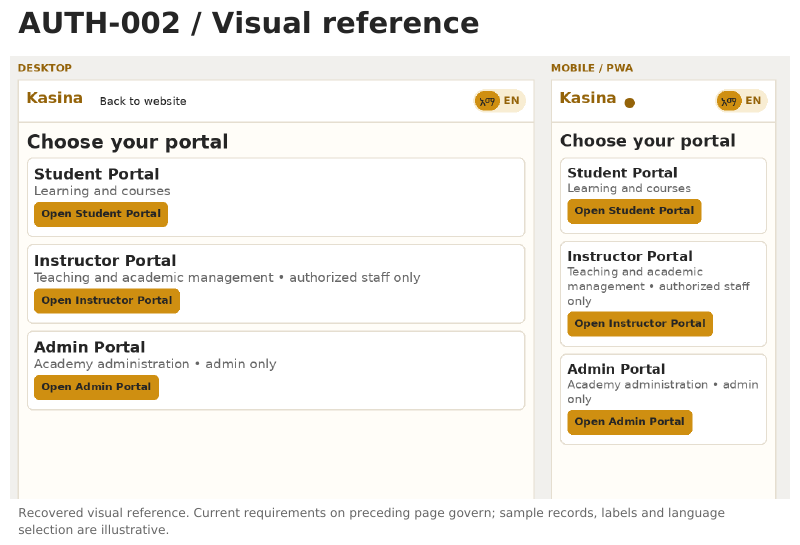

**Behavior and requirements**

One identity, one backend, three portals. Student sees only Student Portal and goes directly there; Instructor sees Student and Instructor; Admin sees all three. No unauthorized portal references. Backend authorization on every request and direct URL. Instructor assigned courses only; admin all courses. Staff student access does not automatically grant paid course enrollment. Switch authorized portal without logout. Telegram always Student Portal, no switch to management. Academy co-owns course content; admin full access. Teacher can publish learning content and announcements independently within assigned course.

**Validation / configuration (open, do not invent):** Exact staff role provisioning and session security in architecture/SRS.

**Desktop layout and controls**

Authenticated role selector Student Portal — Learning and courses Instructor Portal — Teaching and academic management (if authorized) Admin Portal — Academy administration (if authorized)

**Mobile / PWA layout and controls**

Kasina አማ EN Portal selection and switching Same authorized portal cards stacked Student-only: bypass selector Switch portal in account/workspace menu

## Student Portal

### STU-001 — Student — My Learning

Source: KPA-04 v1.1 pages 21–22. Visual reference: 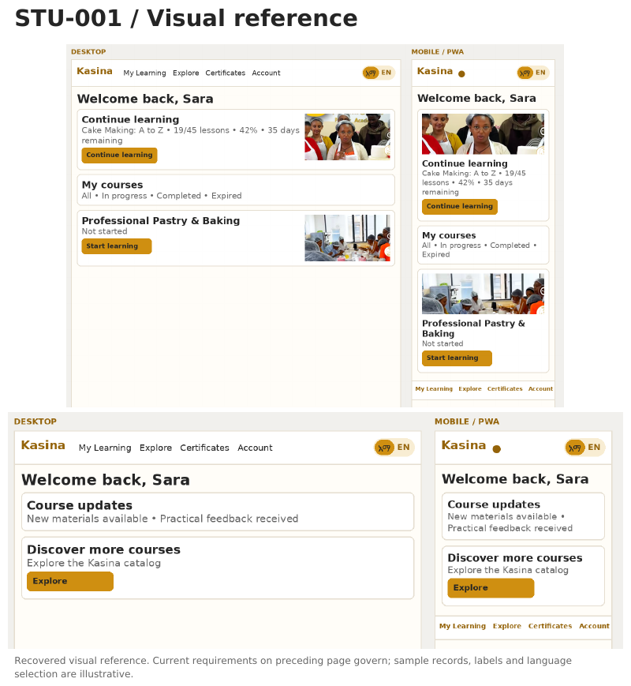

**Behavior and requirements**

Default landing My Learning. Resume exact last lesson, show completed/total and remaining access. New student empty state Explore. Actions: Start learning, Continue learning, Revisit course, View certificate (eligible only), Renew access, View payment status. Progress retained on renewal and expiry; earned certificate remains available. No top-level quizzes/materials/practicals/announcements, gamification or separate dashboard. Public website link in Account. Progress is completed required activities divided by total required activities. Access and academic status are independent. Show completed courses even after expiry; retain certificates.

**Desktop layout and controls**

Logo · My Learning · Explore · Certificates · Account · bell · language Welcome Continue learning: thumbnail / course / next lesson / progress / days left My courses: status filters Course updates Discover more courses

**Mobile / PWA layout and controls**

Logo / bell / language Welcome Continue learning card My courses stacked Course updates Bottom: My Learning · Explore · Certificates · Account

### STU-002 — Student — Explore

Source: KPA-04 v1.1 pages 23–24. Visual reference: 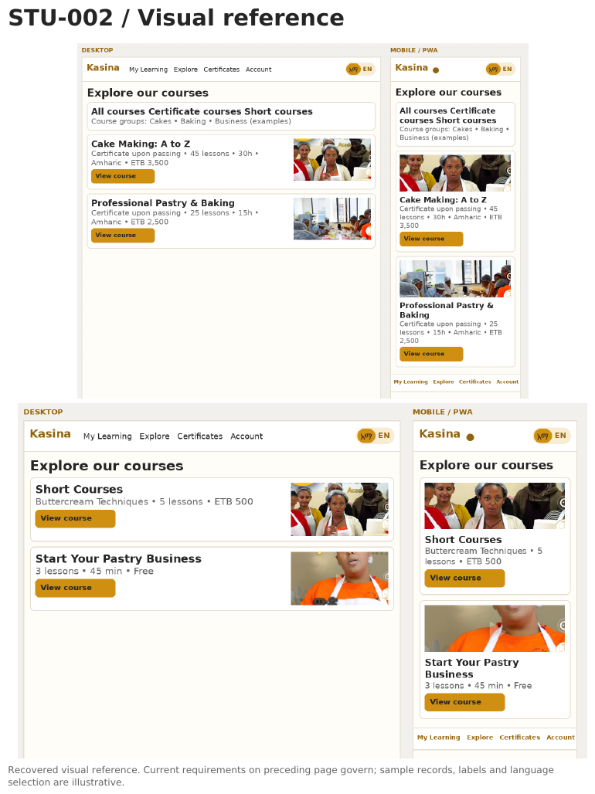

**Behavior and requirements**

Reuse PUB catalog and detail components exactly. Signed-in enrollment bypasses authentication; backend recognizes existing enrollment and prevents duplicate purchase. All personalized academic status belongs in My Learning. Recommendations deferred.

**Validation / configuration (open, do not invent):** No additional layout or feature beyond shared public components.

**Desktop layout and controls**

Student header Same public catalog filters and cards Same course details / previews / Enroll No personalized progress or badges

**Mobile / PWA layout and controls**

Student header Same public mobile catalog Same course details Student bottom navigation

### STU-003 — Enrollment and payment

Source: KPA-04 v1.1 pages 25–26. Visual reference: 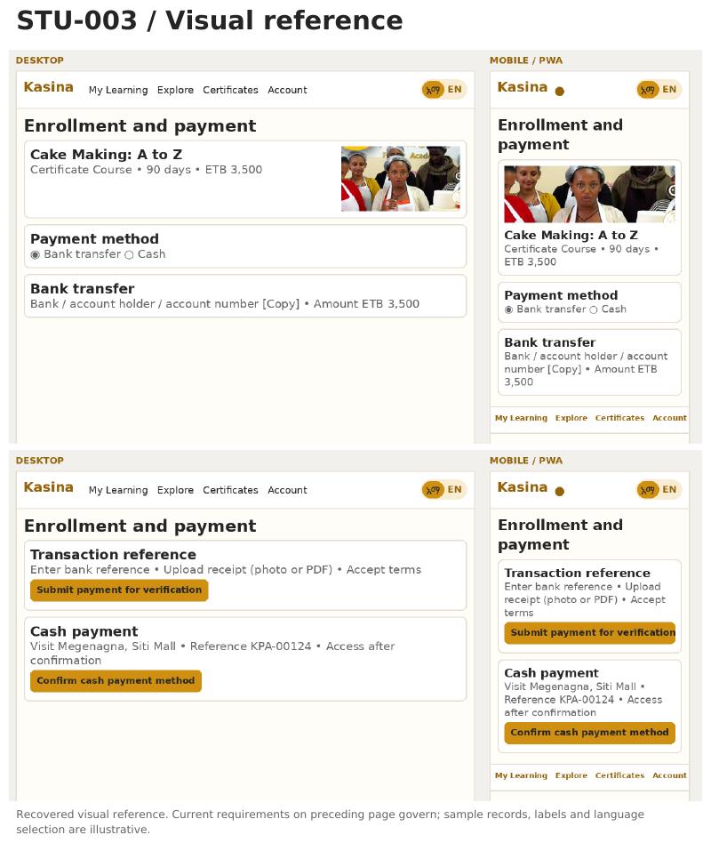

**Behavior and requirements**

Free enrollment immediate; paid access begins after admin confirmation. No cart. Bank transfer: academy account holder, bank/account number, amount, transaction reference, receipt photo/screenshot/PDF. Cash: academy address, enrollment reference, contact, confirmation by admin after receipt of cash. Course-specific access duration default 90 days; renewal preserves progress; prevent duplicate payment and active enrollment. Only admin validates manual payment. Phase 1 bank and cash; Chapa or equivalent later or earlier if ready. Paid access begins on confirmation; free or complimentary access begins on activation. Default 90 days; renewal extends from max(current expiry, confirmation date). Preserve price and receiving account snapshot. No cart or partial payment.

**Desktop layout and controls**

Course summary right: image / title / type / duration / access / fee Left: Bank transfer or Cash Bank account / amount / transaction reference / receipt upload Terms / Submit payment for verification

**Mobile / PWA layout and controls**

Compact course summary Payment method Bank instructions / copy account Reference / receipt upload Submit

### STU-004 — Payment status

Source: KPA-04 v1.1 pages 27–28. Visual reference: 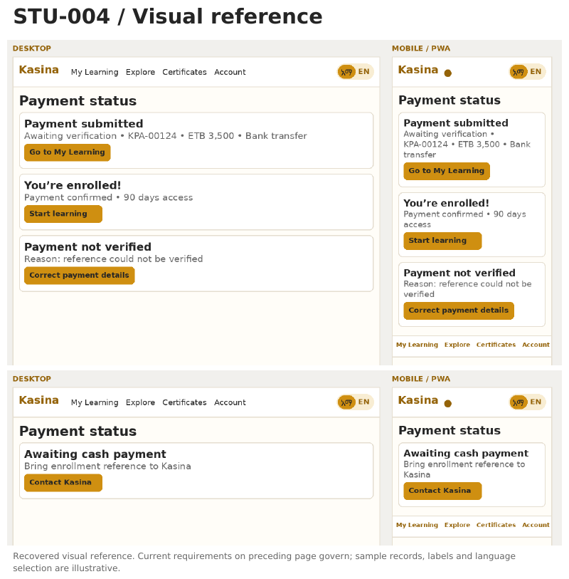

**Behavior and requirements**

Single reusable status page. Student can leave while awaiting verification; confirmation notification. Cash awaiting payment distinct from receipt awaiting verification. Rejection reason and correction flow. History available in Account. No enrollment activation until verified, except free enrollment. Awaiting payment, pending verification, confirmed, rejected and cancelled are distinct. Rejected requests can be corrected with attempt history. Confirm atomically and idempotently; duplicate confirmed reference blocked.

**Desktop layout and controls**

Payment submitted / You’re enrolled! / Payment not verified Course / amount / method / reference / status Pending: Go to My Learning Confirmed: Start learning Rejected: reason / Correct payment details Contact Kasina

**Mobile / PWA layout and controls**

Same status card stacked Primary action full width Contact Kasina

### STU-005 — Course learning interface

Source: KPA-04 v1.1 pages 29–30. Visual reference: 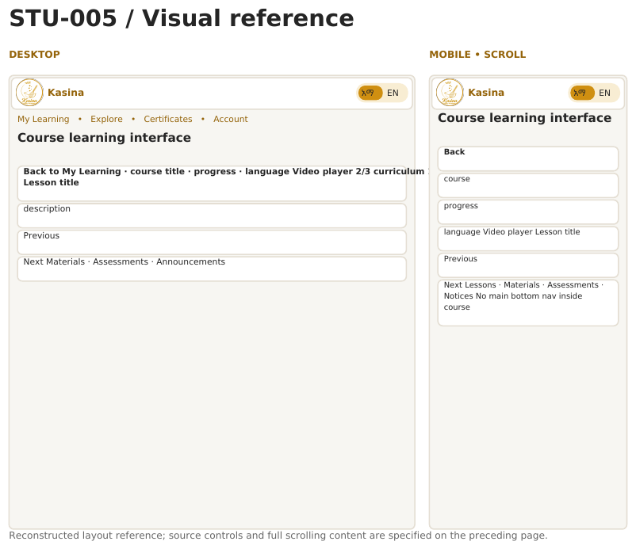

**Behavior and requirements**

Expandable modules, ordered activities; short course flat list. Highlight current item, completed check. Hide empty tabs. Video controls quality/speed/full screen; adaptive streaming, manual low quality if supported, no autoplay or multiple preloads; resume across devices and recover connection. Paid content signed links/watermark, not absolute copy prevention. Exactly three curriculum types: Lesson (text, optional video, attachments, links), Quiz and Practical assessment. Both course types track completion. Video lesson completes after 90% unique playback coverage; text/material-only lesson requires explicit Mark complete. Optional activities excluded. No progression locks.

**Desktop layout and controls**

Back to My Learning · course title · progress · language Video player 2/3 curriculum 1/3 Lesson title / description / Previous / Next Materials · Assessments · Announcements

**Mobile / PWA layout and controls**

Back / course / progress / language Video player Lesson title / Previous / Next Lessons · Materials · Assessments · Notices No main bottom nav inside course

### STU-006 — Assessments — consolidated view

Source: KPA-04 v1.1 pages 31–32. Visual reference: 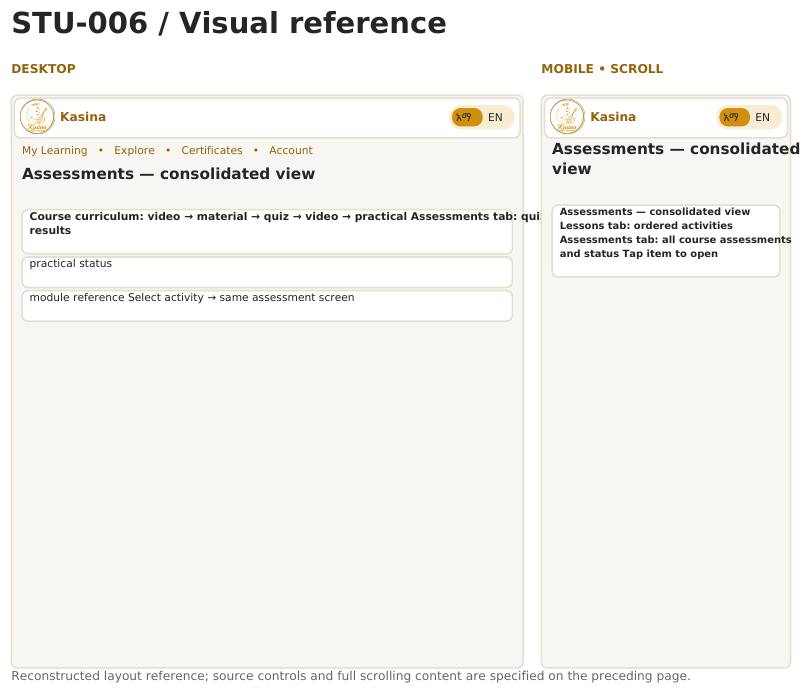

**Behavior and requirements**

One assessments section fetched from what admin or teacher inserted into the course. Quizzes and practicals appear at designated curriculum locations, not separate learning paths. Consolidated tab is a progress/results/outstanding work view. No duplicate data or independent assessment creation from student view. Exactly three activity types: Lesson, Quiz and Practical assessment; reorder in curriculum. Required assessments must pass for successful completion. Continue learning while practical review is pending. Required quiz pass and practical pass count toward completion; optional activities do not.

**Desktop layout and controls**

Course curriculum: video → material → quiz → video → practical Assessments tab: quiz results / practical status / module reference Select activity → same assessment screen

**Mobile / PWA layout and controls**

Kasina አማ EN Assessments — consolidated view Lessons tab: ordered activities Assessments tab: all course assessments and status Tap item to open

### STU-007 — Quiz and results

Source: KPA-04 v1.1 pages 33–34. Visual reference: 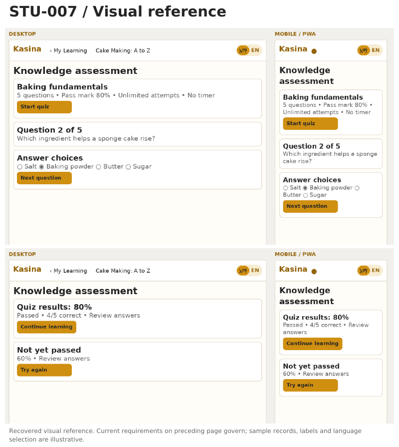

**Behavior and requirements**

No timed exams, scheduling, question banks, random papers, proctoring, essays or negative marks. Default 80%, configurable; unlimited attempts during valid access, no timer. Equal question weights; multiple-choice all correct and no incorrect selections. Preserve best valid pass.

**Desktop layout and controls**

Centered quiz intro: title / module / question count / pass mark One question at a time / options / progress Previous / Next / numbered navigation / Submit Result: score / pass status / review answers / retry

**Mobile / PWA layout and controls**

Back to course / language Question count and progress Question / optional image / answer choices Previous / Next Result and feedback

### STU-008 — Practical assessment and submission

Source: KPA-04 v1.1 pages 35–36. Visual reference: 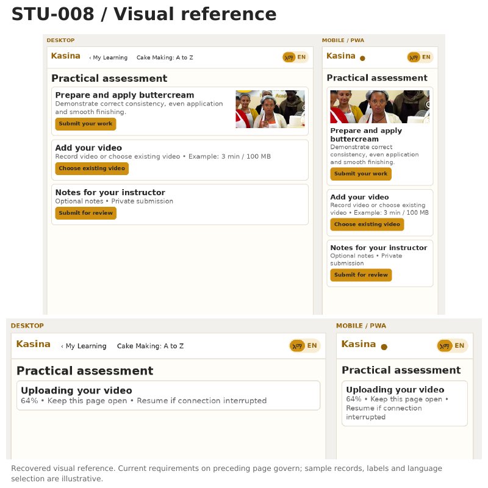

**Behavior and requirements**

Private student video storage distinct from teaching streaming; authorized assigned instructors/admin only. No automatic public reuse. One private video per attempt, optional notes. Initial test envelope 3 minutes / 100 MB; release limits depend on tested mobile uploads and storage. Unlimited attempts during valid access.

**Desktop layout and controls**

Assignment title / optional image Instructions / evaluation criteria / supporting PDF Submit your work Video file / optional notes / upload progress Submit for review

**Mobile / PWA layout and controls**

Kasina አማ EN Practical assessment and submission Assignment in curriculum Instructions / criteria Record video or Choose existing video Optional notes / privacy notice Upload progress / Submit

### STU-009 — Practical review status

Source: KPA-04 v1.1 pages 37–38. Visual reference: 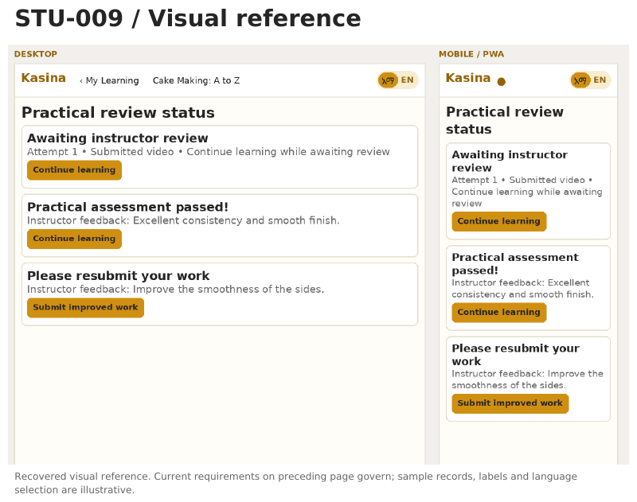

**Behavior and requirements**

Proposed binary Passed/Resubmit, written feedback, resubmissions allowed. Student notified on review; phase 2 bot notification. Status reflected in curriculum and consolidated Assessments tab. Instructor/admin evaluate; system updates academic record and certificate eligibility. Passed or Resubmit; written feedback required for Resubmit. Review timely submissions even after expiry; new submissions require valid access. Preserve attempt history; notify student.

**Desktop layout and controls**

Awaiting instructor review / Passed / Resubmit Submitted video / attempt Written instructor feedback Continue learning or Submit improved work

**Mobile / PWA layout and controls**

Same status card Video preview Feedback Primary action

### STU-010 — Certificates

Source: KPA-04 v1.1 pages 39–40. Visual reference: 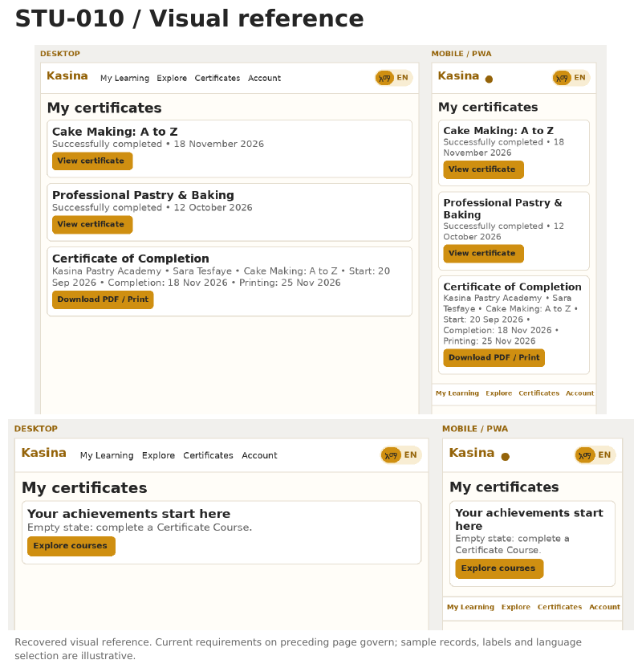

**Behavior and requirements**

Only courses entered as Certificate Course by admin qualify; no separate enable switch. All required academic activities completed/passed; automatic eligibility, no manual application. Short courses never generate certificate or show eligibility prompts. Empty state: Your achievements start here / Explore courses. Completion congratulations with View my certificate only for certificate type; short course simple completion message. Phase 1 placeholder printable document, not automatic national qualification. No QR/public verification, template editor, digital signature or complex numbering. Automatic completion proof only for Certificate Courses. Five fields: student name, course, start date, completion date, print date. One record per enrollment course; reprint after expiry. Admin name correction with reason and audit; no routine manual award. Exceptional invalidation only for verified error or fraud, audited; legal wording and official artwork require confirmation.

**Desktop layout and controls**

My certificates: earned course cards / completion date / View certificate Preview: Kasina logo / Certificate of Completion / student / course / three dates Download PDF · Print

**Mobile / PWA layout and controls**

Earned certificates stacked PDF preview Download PDF primary Bottom navigation

### STU-011 — Account, history, notifications and support

Source: KPA-04 v1.1 pages 41–42. Visual reference: 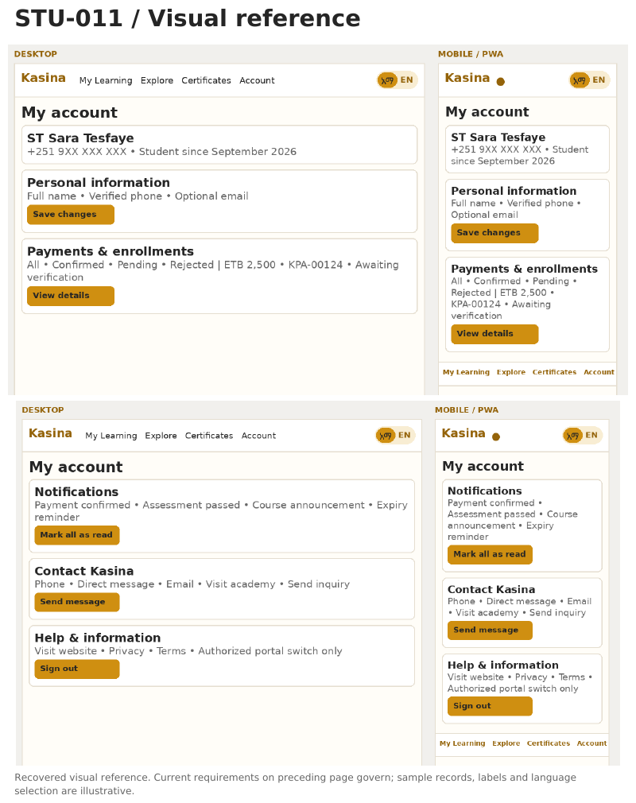

**Behavior and requirements**

Bell: payment confirmation, assessment result, announcement, expiry, certificate; deep link to relevant record, mark read. In-app notices, important SMS; optional email, Telegram bot phase 2. Avoid SMS for every lesson. Account > Contact Kasina includes private conversation history and replies; no new main navigation. Public inquiry form in About contact section. Existing bell alerts replies. Phone changes require verification.

**Desktop layout and controls**

Kasina አማ EN Account, history, notifications and support Account profile / initials / phone Personal information · Payments & enrollments · Notification preferences Contact Kasina · Visit website · Privacy · Terms Authorized Switch portal / Sign out Bell opens notifications

**Mobile / PWA layout and controls**

Kasina አማ EN Account, history, notifications and support Same grouped menu Personal information: name / verified phone / optional email History cards / status / reference Contact options / inquiry Bottom navigation

## Shared academic editor (instructor and admin)

### ACD-001 — Shared editor — details

Source: KPA-04 v1.1 pages 43–44. Visual reference: 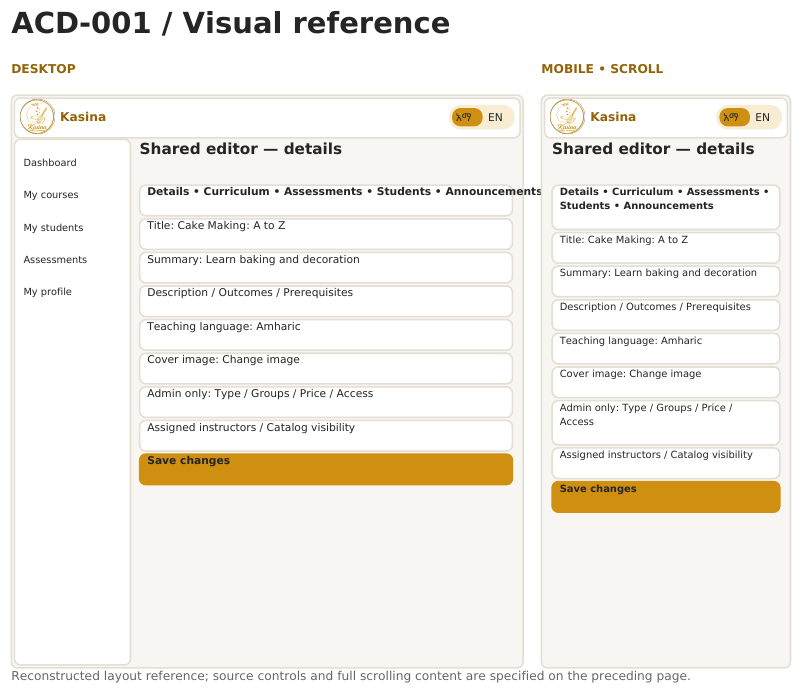

**Behavior and requirements**

Same components for instructor and admin; management settings hidden from instructors. Admin creates draft, saves Details, proceeds to Curriculum, optionally reviews Assessments, then previews and publishes. Students and Announcements are operational tabs, not creation steps. Existing courses allow free tab navigation. Admin controls type, groups, price, duration, assignment, catalog publication and archive. Groups are reusable, searchable and create-on-type. Instructor edits academic details and publishes academic content independently. Server enforces role and course scope.

**Desktop layout and controls**

Details | Curriculum | Assessments | Students | Announcements Academic details / Title: Cake Making: A to Z / Summary: Learn baking and decoration / Description · Outcomes · Prerequisites / Teaching language: Amharic / Cover image: Change image Admin-only management / Type: Certificate Course / Groups: Cake making, Decoration / Price: ETB 3,500 | Access: 90 days / Assigned instructors: Meron, Hana / Catalog visibility: Published / Save changes

**Mobile / PWA layout and controls**

Details | Curriculum | Assessments | Students | Announcements Academic details / Title: Cake Making: A to Z / Summary: Learn baking and decoration / Description · Outcomes · Prerequisites / Teaching language: Amharic / Cover image: Change image Admin-only management / Type: Certificate Course / Groups: Cake making, Decoration / Price: ETB 3,500 | Access: 90 days / Assigned instructors: Meron, Hana / Catalog visibility: Published / Save changes

### ACD-002 — Curriculum

Source: KPA-04 v1.1 pages 45–46. Visual reference: 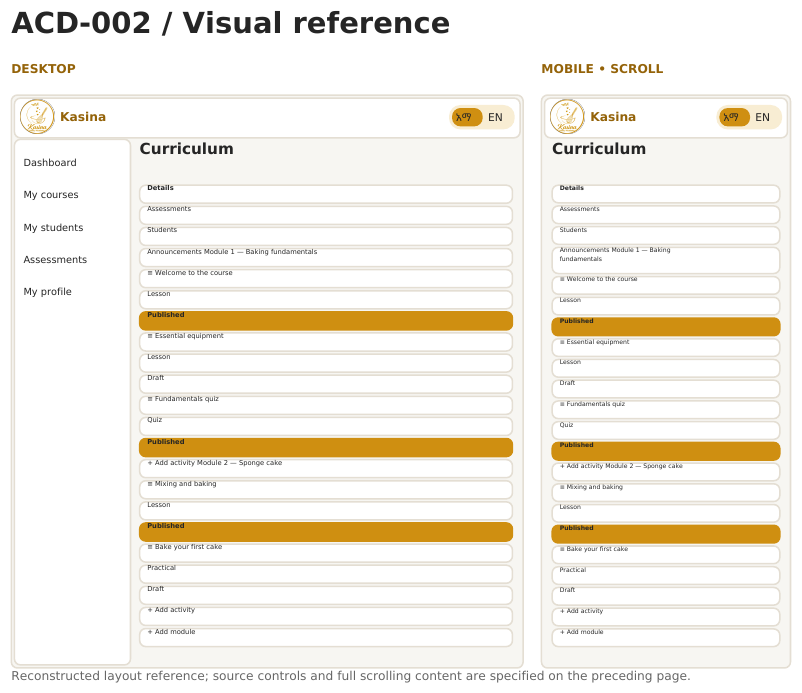

**Behavior and requirements**

Exactly three ordered activity types: Lesson, Quiz, Practical assessment. Modules optional; flat short courses supported. Expand/collapse, drag reorder and move up/down menu for mobile. Draft/publish activities independently; admin alone publishes or withdraws catalog course. Add activity opens type selection. Editing returns to original curriculum position. Preserve progress on reorder; archive records rather than destroy history. Changes to required activities in active courses need warning and policy confirmation.

**Desktop layout and controls**

Details | Curriculum | Assessments | Students | Announcements Module 1 — Baking fundamentals / ≡ Welcome to the course | Lesson | Published / ≡ Essential equipment | Lesson | Draft / ≡ Fundamentals quiz | Quiz | Published / + Add activity Module 2 — Sponge cake / ≡ Mixing and baking | Lesson | Published / ≡ Bake your first cake | Practical | Draft / + Add activity / + Add module

**Mobile / PWA layout and controls**

Details | Curriculum | Assessments | Students | Announcements Module 1 — Baking fundamentals / ≡ Welcome to the course | Lesson | Published / ≡ Essential equipment | Lesson | Draft / ≡ Fundamentals quiz | Quiz | Published / + Add activity Module 2 — Sponge cake / ≡ Mixing and baking | Lesson | Published / ≡ Bake your first cake | Practical | Draft / + Add activity / + Add module

### ACD-003 — Unified lesson editor

Source: KPA-04 v1.1 pages 47–48. Visual reference: 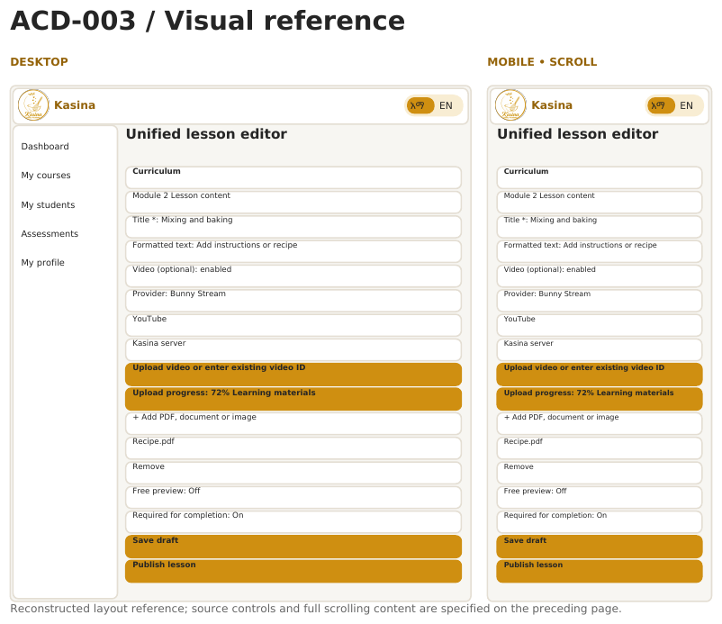

**Behavior and requirements**

Title and at least one content element required. Optional formatted text, video and multiple attachments; links within text. Text-only or document-only lessons render without empty player. Materials tab is derived from attachments. Bunny protected streaming recommended for paid content; direct browser upload or existing ID. YouTube public/unlisted link only; not protected. Kasina server direct upload for short/small videos, authenticated access, no adaptive streaming by default. Admin centrally enables providers and limits. Paid YouTube warning proposed; exact restrictions pending.

**Desktop layout and controls**

Curriculum / Module 2 Lesson content / Title *: Mixing and baking / Formatted text: Add instructions or recipe / Video (optional): enabled / Provider: Bunny Stream / YouTube / Kasina server / Upload video or enter existing video ID / Upload progress: 72% Learning materials / + Add PDF, document or image / Recipe.pdf | Remove / Free preview: Off / Required for completion: On / Save draft / Publish lesson

**Mobile / PWA layout and controls**

Curriculum / Module 2 Lesson content / Title *: Mixing and baking / Formatted text: Add instructions or recipe / Video (optional): enabled / Provider: Bunny Stream / YouTube / Kasina server / Upload video or enter existing video ID / Upload progress: 72% Learning materials / + Add PDF, document or image / Recipe.pdf | Remove / Free preview: Off / Required for completion: On / Save draft / Publish lesson

### ACD-004 — Lesson video states

Source: KPA-04 v1.1 pages 49–50. Visual reference: 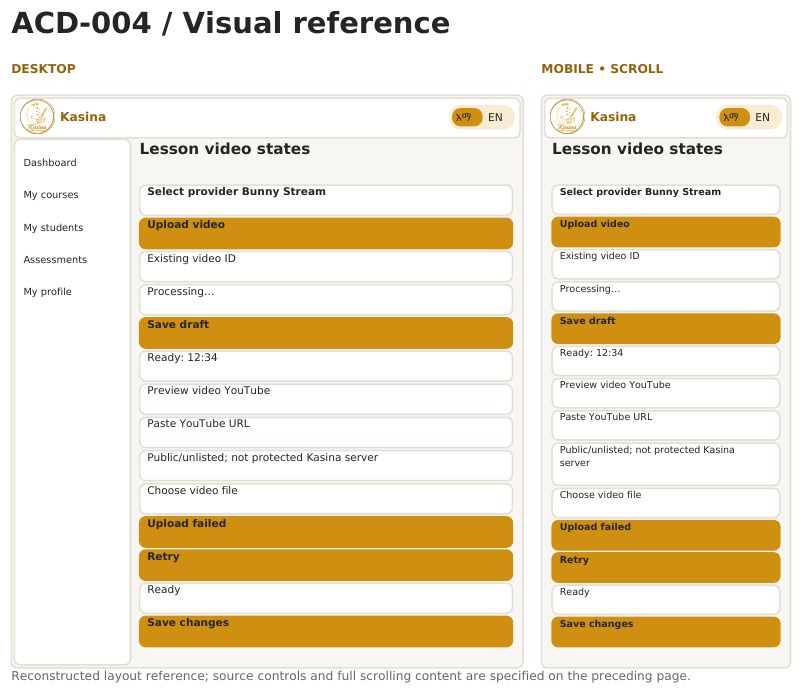

**Behavior and requirements**

Provider selection shown only when video enabled. Show progress, processing, failure/retry and ready states. Preserve unsaved fields during upload failure and language switch. Publish video lesson only when playable. No permanent Bunny credentials in browser. Server limits, accepted formats, retention, YouTube completion validation and paid-content policy remain pending. Protection is deterrence, not a guarantee against copying.

**Desktop layout and controls**

Select provider Bunny Stream / Upload video | Existing video ID / Processing… | Save draft / Ready: 12:34 | Preview video YouTube / Paste YouTube URL / Public/unlisted; not protected Kasina server / Choose video file / Upload failed | Retry / Ready | Save changes

**Mobile / PWA layout and controls**

Select provider Bunny Stream / Upload video | Existing video ID / Processing… | Save draft / Ready: 12:34 | Preview video YouTube / Paste YouTube URL / Public/unlisted; not protected Kasina server / Choose video file / Upload failed | Retry / Ready | Save changes

### ACD-005 — Quiz editor

Source: KPA-04 v1.1 pages 51–52. Visual reference: 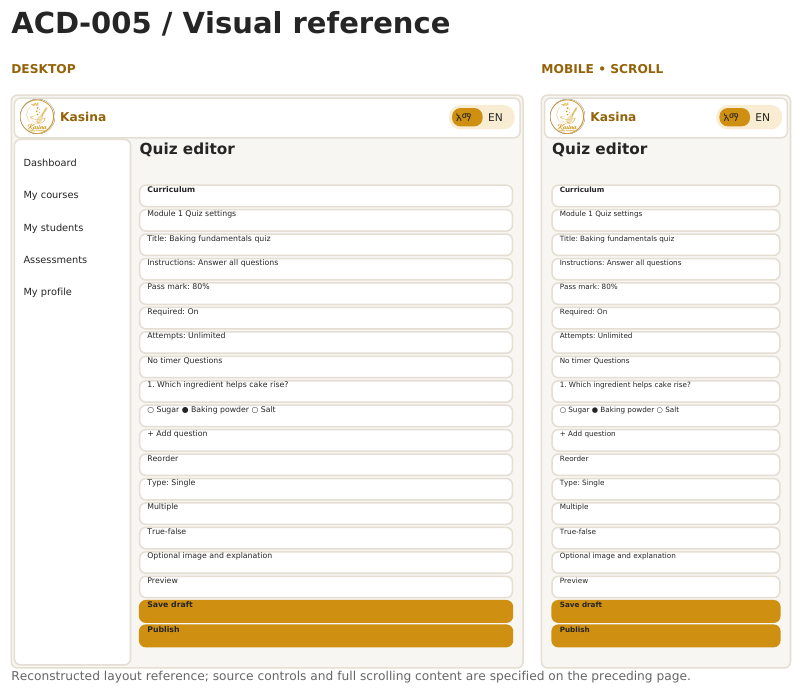

**Behavior and requirements**

Proposed defaults: 80% pass, unlimited attempts, no timer, equal marks, multiple-choice all correct for credit. Automatic server grading; best valid pass retained. Questions editable/reorderable; optional image and explanation. Student answers saved progressively; historical attempts retained when content changes. No question bank, essays, proctoring or complex scoring.

**Desktop layout and controls**

Curriculum / Module 1 Quiz settings / Title: Baking fundamentals quiz / Instructions: Answer all questions / Pass mark: 80% | Required: On / Attempts: Unlimited | No timer Questions / 1. Which ingredient helps cake rise? / ○ Sugar ● Baking powder ○ Salt / + Add question | Reorder / Type: Single / Multiple / True-false / Optional image and explanation / Preview / Save draft / Publish

**Mobile / PWA layout and controls**

Curriculum / Module 1 Quiz settings / Title: Baking fundamentals quiz / Instructions: Answer all questions / Pass mark: 80% | Required: On / Attempts: Unlimited | No timer Questions / 1. Which ingredient helps cake rise? / ○ Sugar ● Baking powder ○ Salt / + Add question | Reorder / Type: Single / Multiple / True-false / Optional image and explanation / Preview / Save draft / Publish

### ACD-006 — Practical assessment editor

Source: KPA-04 v1.1 pages 53–54. Visual reference: 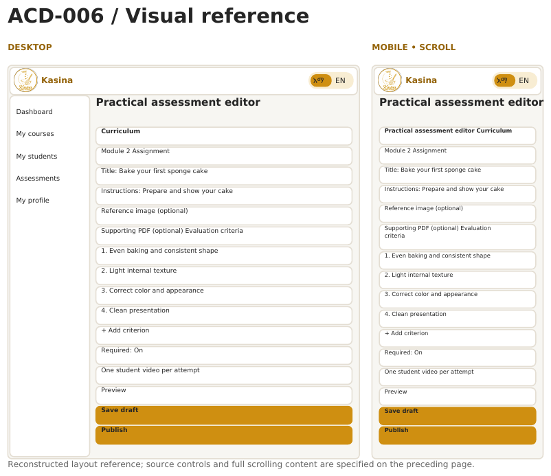

**Behavior and requirements**

Student records or selects a video and adds optional notes. Private upload with progress and retry; no custom recorder required. One video per attempt; size/duration and retention pending. Evaluation is Passed or Resubmit, no weighted grades. Instructor/admin review only assigned scope. Required assessments count toward completion; no separate approval hierarchy.

**Desktop layout and controls**

Curriculum / Module 2 Assignment / Title: Bake your first sponge cake / Instructions: Prepare and show your cake / Reference image (optional) / Supporting PDF (optional) Evaluation criteria / 1. Even baking and consistent shape / 2. Light internal texture / 3. Correct color and appearance / 4. Clean presentation / + Add criterion / Required: On | One student video per attempt / Preview / Save draft / Publish

**Mobile / PWA layout and controls**

Kasina አማ EN Practical assessment editor Curriculum / Module 2 Assignment / Title: Bake your first sponge cake / Instructions: Prepare and show your cake / Reference image (optional) / Supporting PDF (optional) Evaluation criteria / 1. Even baking and consistent shape / 2. Light internal texture / 3. Correct color and appearance / 4. Clean presentation / + Add criterion / Required: On | One student video per attempt / Preview / Save draft / Publish

### ACD-007 — Assessments overview

Source: KPA-04 v1.1 pages 55–56. Visual reference: 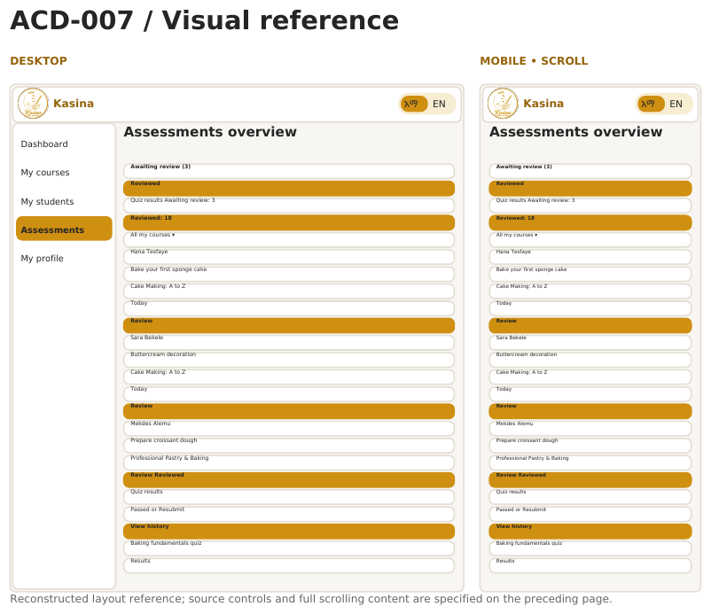

**Behavior and requirements**

Top-level aggregates assigned courses; admin sees all. Default pending queue, course filter, reviewed history and automatic quiz results. Dashboard links to same records. Course tab lists assessments in curriculum order with Results/Review and Edit assessment links to existing editor. No independent assessment library or ordering. Counts distinguish attempts from unique students. Empty states for no matching records.

**Desktop layout and controls**

Awaiting review (3) | Reviewed | Quiz results Awaiting review: 3 | Reviewed: 18 / All my courses ▾ / Hana Tesfaye | Bake your first sponge cake / Cake Making: A to Z | Today | Review / Sara Bekele | Buttercream decoration / Cake Making: A to Z | Today | Review / Mekdes Alemu | Prepare croissant dough / Professional Pastry & Baking | Review Reviewed / Quiz results / Passed or Resubmit | View history / Baking fundamentals quiz | Results / 24 attempts | 21 passed attempts

**Mobile / PWA layout and controls**

Awaiting review (3) | Reviewed | Quiz results Awaiting review: 3 | Reviewed: 18 / All my courses ▾ / Hana Tesfaye | Bake your first sponge cake / Cake Making: A to Z | Today | Review / Sara Bekele | Buttercream decoration / Cake Making: A to Z | Today | Review / Mekdes Alemu | Prepare croissant dough / Professional Pastry & Baking | Review Reviewed / Quiz results / Passed or Resubmit | View history / Baking fundamentals quiz | Results / 24 attempts | 21 passed attempts

### ACD-008 — Practical submission review

Source: KPA-04 v1.1 pages 57–58. Visual reference: 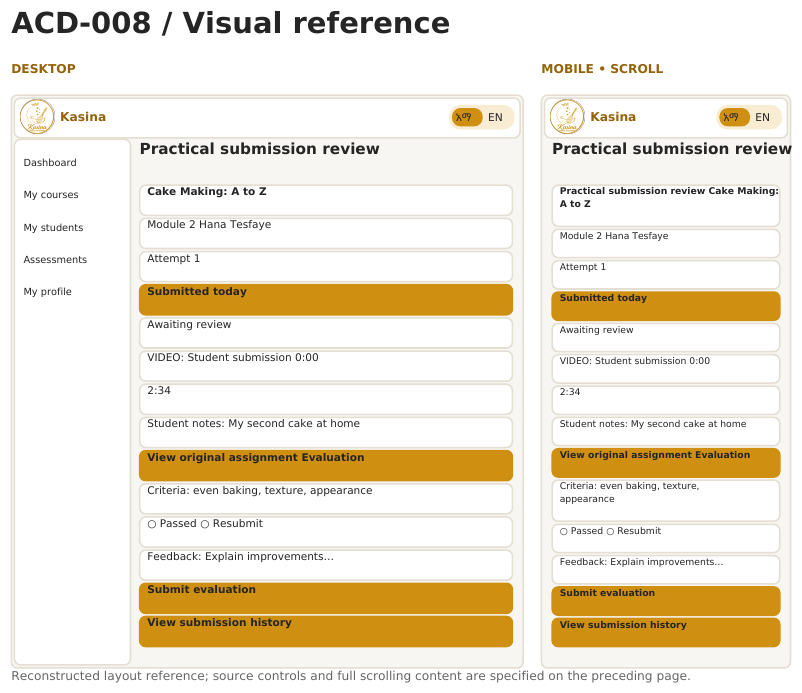

**Behavior and requirements**

Desktop video and notes left, evaluation right; mobile stacked. Require explicit decision; feedback mandatory for Resubmit, optional for Passed. Leaving without submission keeps pending. Notify student after evaluation. Shared queue across assigned instructors/admin. Atomic review prevents overwriting concurrent evaluation; show existing reviewer. No manual reviewer assignment. Previous attempts, dates, feedback and reviewer preserved; videos subject to retention policy.

**Desktop layout and controls**

Cake Making: A to Z / Module 2 Hana Tesfaye | Attempt 1 / Submitted today | Awaiting review / VIDEO: Student submission 0:00 / 2:34 / Student notes: My second cake at home / View original assignment Evaluation / Criteria: even baking, texture, appearance / ○ Passed ○ Resubmit / Feedback: Explain improvements… / Submit evaluation / View submission history

**Mobile / PWA layout and controls**

Kasina አማ EN Practical submission review Cake Making: A to Z / Module 2 Hana Tesfaye | Attempt 1 / Submitted today | Awaiting review / VIDEO: Student submission 0:00 / 2:34 / Student notes: My second cake at home / View original assignment Evaluation / Criteria: even baking, texture, appearance / ○ Passed ○ Resubmit / Feedback: Explain improvements… / Submit evaluation / View submission history

### ACD-009 — Quiz results and course assessments

Source: KPA-04 v1.1 pages 59–60. Visual reference: 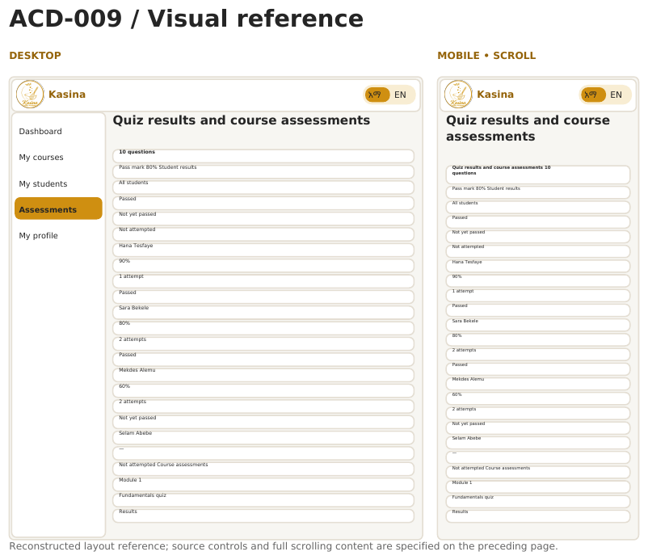

**Behavior and requirements**

Select student for attempt history, submitted answers, correct answers, scores and dates. No manual score adjustment or advanced analytics in Phase 1. Best valid pass retained even after retake. Course completion automatically follows required lessons completed and required assessments passed. Certificate Course issues basic certificate; Short Course only marks completion. No instructor certificate approval.

**Desktop layout and controls**

10 questions | Pass mark 80% Student results / All students / Passed / Not yet passed / Not attempted / Hana Tesfaye | 90% | 1 attempt | Passed / Sara Bekele | 80% | 2 attempts | Passed / Mekdes Alemu | 60% | 2 attempts | Not yet passed / Selam Abebe | — | Not attempted Course assessments / Module 1 | Fundamentals quiz | Results / Module 2 | Bake your first cake | Review / Edit assessment → existing editor

**Mobile / PWA layout and controls**

Kasina አማ EN Quiz results and course assessments 10 questions | Pass mark 80% Student results / All students / Passed / Not yet passed / Not attempted / Hana Tesfaye | 90% | 1 attempt | Passed / Sara Bekele | 80% | 2 attempts | Passed / Mekdes Alemu | 60% | 2 attempts | Not yet passed / Selam Abebe | — | Not attempted Course assessments / Module 1 | Fundamentals quiz | Results / Module 2 | Bake your first cake | Review / Edit assessment → existing editor

### ACD-010 — Individual academic record

Source: KPA-04 v1.1 pages 61–62. Visual reference: 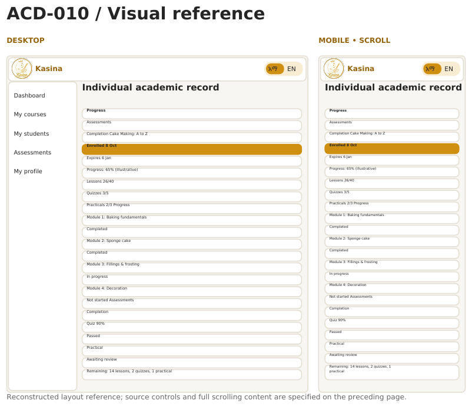

**Behavior and requirements**

Course selector limited to authorized enrollments. Progress expands modules and lesson statuses. Assessments links to existing review/results. Completion lists outstanding requirements; certificate eligibility only for Certificate Course. Admin adds Enrollments, Payments and Account controls to same record. Progress = completed required activities / total required activities; 31/48 = 65% rounded.

**Desktop layout and controls**

Progress | Assessments | Completion Cake Making: A to Z / Enrolled 8 Oct | Expires 6 Jan / Progress: 65% (illustrative) / Lessons 26/40 | Quizzes 3/5 | Practicals 2/3 Progress / Module 1: Baking fundamentals | Completed / Module 2: Sponge cake | Completed / Module 3: Fillings & frosting | In progress / Module 4: Decoration | Not started Assessments / Completion / Quiz 90% | Passed / Practical | Awaiting review / Remaining: 14 lessons, 2 quizzes, 1 practical

**Mobile / PWA layout and controls**

Progress | Assessments | Completion Cake Making: A to Z / Enrolled 8 Oct | Expires 6 Jan / Progress: 65% (illustrative) / Lessons 26/40 | Quizzes 3/5 | Practicals 2/3 Progress / Module 1: Baking fundamentals | Completed / Module 2: Sponge cake | Completed / Module 3: Fillings & frosting | In progress / Module 4: Decoration | Not started Assessments / Completion / Quiz 90% | Passed / Practical | Awaiting review / Remaining: 14 lessons, 2 quizzes, 1 practical

### ACD-011 — Course announcements

Source: KPA-04 v1.1 pages 63–64. Visual reference: 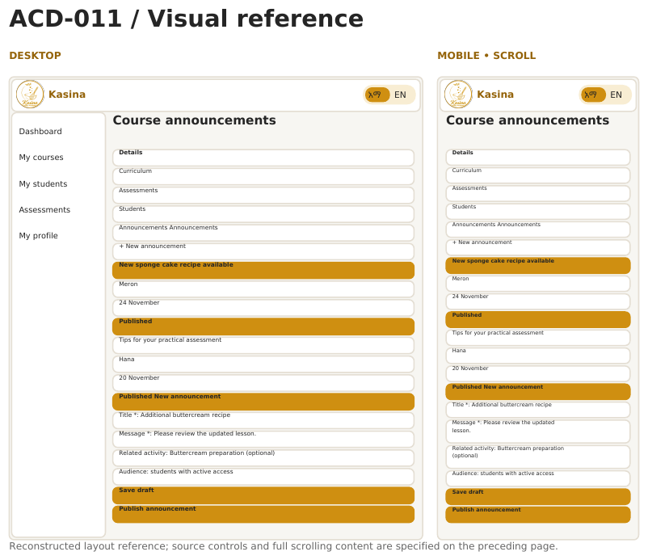

**Behavior and requirements**

Shared course editor tab; newest first. Title and formatted message required; optional link to published activity. Attach files through lesson materials, not separate announcement uploads. Draft, publish, edit, unpublish, delete with confirmation. Publication sends in-app notice; routine edits do not resend. No routine SMS, comments, replies or scheduling. Active-access recipient rule and admin academy-wide announcements proposed. Student My Learning updates, bell and course history use same records; Telegram bot Phase 2.

**Desktop layout and controls**

Details | Curriculum | Assessments | Students | Announcements Announcements | + New announcement / New sponge cake recipe available / Meron | 24 November | Published / Tips for your practical assessment / Hana | 20 November | Published New announcement / Title *: Additional buttercream recipe / Message *: Please review the updated lesson. / Related activity: Buttercream preparation (optional) / Audience: students with active access / Save draft / Publish announcement

**Mobile / PWA layout and controls**

Details | Curriculum | Assessments | Students | Announcements Announcements | + New announcement / New sponge cake recipe available / Meron | 24 November | Published / Tips for your practical assessment / Hana | 20 November | Published New announcement / Title *: Additional buttercream recipe / Message *: Please review the updated lesson. / Related activity: Buttercream preparation (optional) / Audience: students with active access / Save draft / Publish announcement

## Instructor Portal

### INS-001 — Instructor Dashboard

Source: KPA-04 v1.1 pages 65–66. Visual reference: 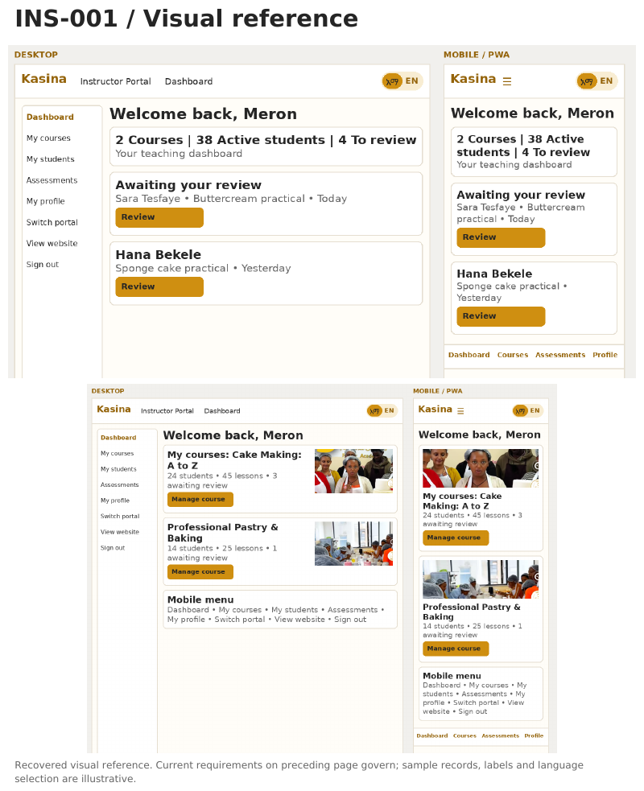

**Behavior and requirements**

Dashboard not Overview. Assigned courses only; summary numbers fetched from actual course/enrollment/submission records. Pending reviews prioritized; shortcuts to same assessment review and course editor. No separate dashboard configuration. No assigned courses: explanatory empty state. Full hamburger includes My students and workspace links. Instructor only sees authorized portals. Multiple instructors on same course see shared academic records; review updates for everyone. Instructor cannot create commercial course, set type/price, assign staff, publish public catalog, validate payment, manage access or certificates. Can publish academic content/announcements independently and evaluate assigned students. Admin all courses. No earnings, payouts, complex analytics, internal chat or task system. Shared queue; review commit checks attempt version and rejects stale duplicate evaluation. Instructor assigned academic scope only.

**Validation / configuration (open, do not invent):** Light sidebar, priority order, count definitions and multi-instructor review concurrency to validate.

**Desktop layout and controls**

Light sidebar: Dashboard / My courses / My students / Assessments / My profile Workspace: Switch portal / View website / Sign out Header: Dashboard / bell / language / initials Welcome / 3 summary cards Awaiting your review: student / assignment / course / date / Review My courses: thumbnail / type / active students / lessons / pending reviews / Manage course

**Mobile / PWA layout and controls**

Hamburger / Kasina / bell / language Welcome Courses · Students · To review Pending submissions Assigned course cards Bottom: Dashboard · Courses · Assessments · Profile

### INS-002 — My courses

Source: KPA-04 v1.1 pages 67–68. Visual reference: 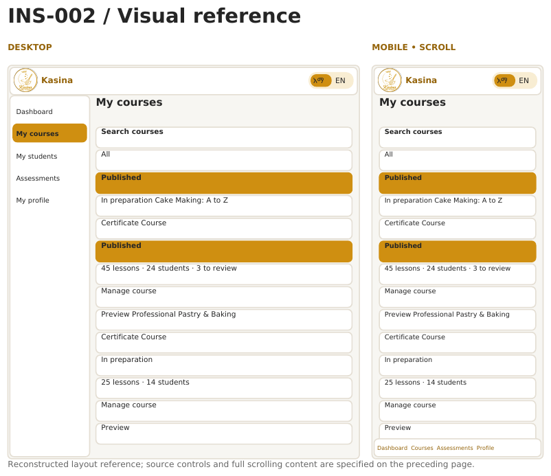

**Behavior and requirements**

Assigned courses only; no create-course action for instructors. Admin uses Manage courses with all records and New course. Search and status filters; cards show thumbnail, type, status, last updated, counts and actions. Preview uses the student learning interface without enrollment or progress mutation. Empty state explains that an admin must assign a course.

**Desktop layout and controls**

My students Assessments My profile My courses Search courses | All / Published / In preparation Cake Making: A to Z / Certificate Course | Published / 45 lessons · 24 students · 3 to review / Manage course / Preview Professional Pastry & Baking / Certificate Course | In preparation / 25 lessons · 14 students / Manage course / Preview

**Mobile / PWA layout and controls**

Search courses | All / Published / In preparation Cake Making: A to Z / Certificate Course | Published / 45 lessons · 24 students · 3 to review / Manage course / Preview Professional Pastry & Baking / Certificate Course | In preparation / 25 lessons · 14 students / Manage course / Preview

### INS-003 — My students

Source: KPA-04 v1.1 pages 69–70. Visual reference: 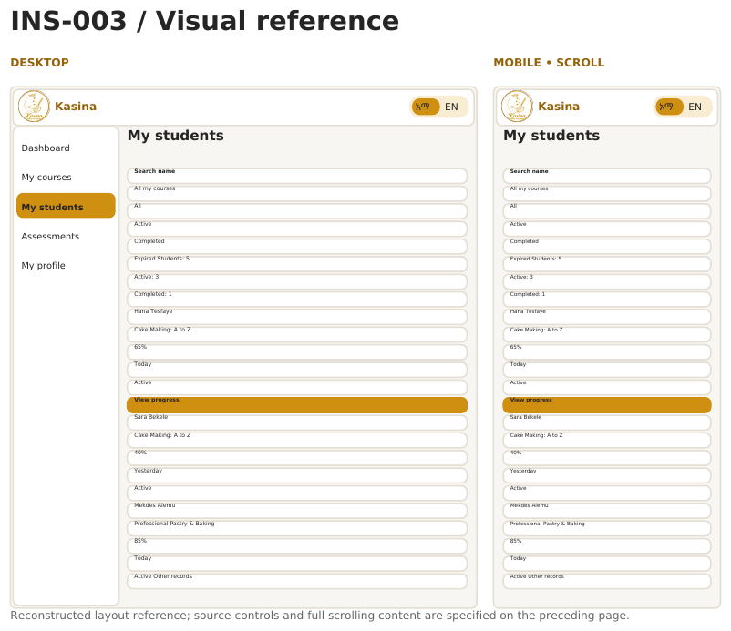

**Behavior and requirements**

Same list within course Students tab with course filter fixed. One student identity across courses; course-level records remain distinct. Admin all students; instructor assigned course academic data only. Show progress, last activity and access status. Completion and access expiry are separate dimensions in implementation. Admin alone manages enrollment, access, account, payments and certificates. No direct messaging proposed; announcements and assessment feedback suffice.

**Desktop layout and controls**

Assessments My profile My students Search name | All my courses | All / Active / Completed / Expired Students: 5 | Active: 3 | Completed: 1 / Hana Tesfaye | Cake Making: A to Z / 65% | Today | Active | View progress / Sara Bekele | Cake Making: A to Z / 40% | Yesterday | Active / Mekdes Alemu | Professional Pastry & Baking / 85% | Today | Active Other records / Rahel Tadesse | 100% | Completed / Selam Abebe | 25% | Expired

**Mobile / PWA layout and controls**

Search name | All my courses | All / Active / Completed / Expired Students: 5 | Active: 3 | Completed: 1 / Hana Tesfaye | Cake Making: A to Z / 65% | Today | Active | View progress / Sara Bekele | Cake Making: A to Z / 40% | Yesterday | Active / Mekdes Alemu | Professional Pastry & Baking / 85% | Today | Active Other records / Rahel Tadesse | 100% | Completed / Selam Abebe | 25% | Expired

### INS-004 — My profile

Source: KPA-04 v1.1 pages 71–72. Visual reference: 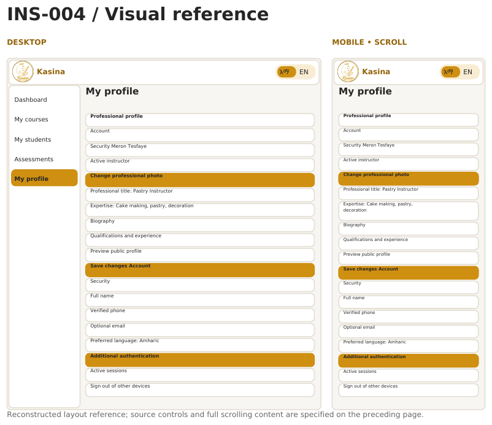

**Behavior and requirements**

One professional profile feeds About Kasina and assigned course pages when admin enables visibility. Instructor edits own professional information; bilingual fields. Personal phone/email and security data never public. Reuse account components; admin controls role, assignments, activation and public visibility. Staff departure removes access while preserving academic content and attribution. No MFA in Phase 1 [v1.2: D-04]; Security tab shows active sessions and Sign out of other devices only. No earnings, ratings or storefront.

**Desktop layout and controls**

My profile Professional profile | Account | Security Meron Tesfaye | Active instructor / Change professional photo / Professional title: Pastry Instructor / Expertise: Cake making, pastry, decoration / Biography | Qualifications and experience / Preview public profile | Save changes Account / Security / Full name | Verified phone | Optional email / Preferred language: Amharic / Active sessions / Sign out of other devices [v1.2: 'Additional authentication' removed, D-04]

**Mobile / PWA layout and controls**

Professional profile | Account | Security Meron Tesfaye | Active instructor / Change professional photo / Professional title: Pastry Instructor / Expertise: Cake making, pastry, decoration / Biography | Qualifications and experience / Preview public profile | Save changes Account / Security / Full name | Verified phone | Optional email / Preferred language: Amharic / Active sessions / Sign out of other devices [v1.2: 'Additional authentication' removed, D-04]

## Admin Portal

### ADM-001 — Admin dashboard

Source: KPA-04 v1.1 pages 73–74. Visual reference: 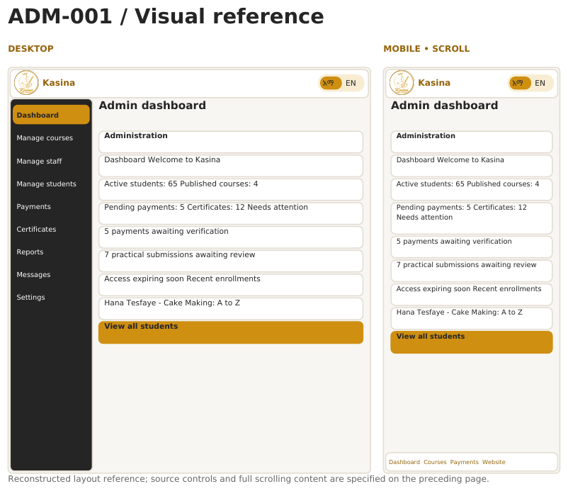

**Behavior and requirements**

Operational summary from existing records, not a separate data store. Link each action to the corresponding filtered management screen. No decorative analytics. Navigation order: Dashboard, Manage courses, Manage staff, Manage students, Payments, Certificates, Reports, Messages, Settings. Mobile shortcuts Dashboard, Courses, Payments, Website.

**Desktop layout and controls**

Administration / Dashboard Welcome to Kasina / Active students: 65 Published courses: 4 / Pending payments: 5 Certificates: 12 Needs attention / 5 payments awaiting verification / 7 practical submissions awaiting review / Access expiring soon Recent enrollments / Hana Tesfaye - Cake Making: A to Z / View all students

**Mobile / PWA layout and controls**

Administration / Dashboard Welcome to Kasina / Active students: 65 Published courses: 4 / Pending payments: 5 Certificates: 12 Needs attention / 5 payments awaiting verification / 7 practical submissions awaiting review / Access expiring soon Recent enrollments / Hana Tesfaye - Cake Making: A to Z / View all students

### ADM-002 — Manage courses

Source: KPA-04 v1.1 pages 75–76. Visual reference: 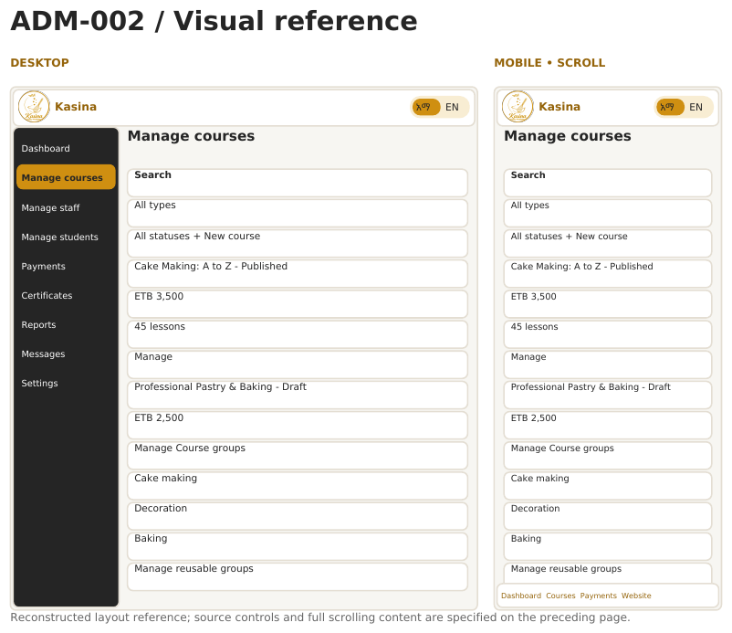

**Behavior and requirements**

Reuse the five-tab academic editor in ACD-001–011. Admin adds commercial controls, instructor assignment, catalog publishing and archive. No duplicate lesson editor. Course groups reusable and bilingual; create on type. Archive rather than destroy records.

**Desktop layout and controls**

Manage staff Manage students Payments Certificates Reports Messages Settings Manage courses Search / All types / All statuses + New course / Cake Making: A to Z - Published / ETB 3,500 / 45 lessons / Manage / Professional Pastry & Baking - Draft / ETB 2,500 / Manage Course groups / Cake making / Decoration / Baking / Manage reusable groups

**Mobile / PWA layout and controls**

Search / All types / All statuses + New course / Cake Making: A to Z - Published / ETB 3,500 / 45 lessons / Manage / Professional Pastry & Baking - Draft / ETB 2,500 / Manage Course groups / Cake making / Decoration / Baking / Manage reusable groups

### ADM-003 — Manage staff

Source: KPA-04 v1.1 pages 77–78. Visual reference: 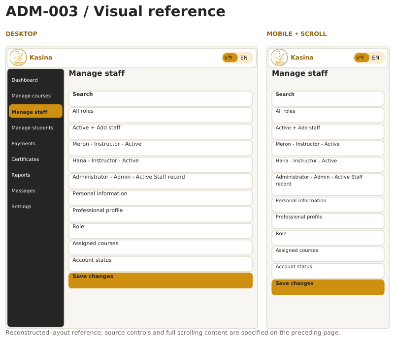

**Behavior and requirements**

Admin provisions staff; public registration creates students only. Assign courses and manage public professional visibility. Disable departed staff without deleting academic history. Shared identity and security components. Revoke sessions on disable and prevent disabling the last active administrator. Staff phone changes are made by the administrator after identity verification, audited, and revoke sessions. If the only administrator loses their phone, recovery is an operator procedure run by Hulu on the server (audited, documented in the runbook) [v1.2: D-03, D-04].

**Desktop layout and controls**

Manage students Payments Certificates Reports Messages Settings Manage staff Search / All roles / Active + Add staff / Meron - Instructor - Active / Hana - Instructor - Active / Administrator - Admin - Active Staff record / Personal information / Professional profile / Role / Assigned courses / Account status / Save changes

**Mobile / PWA layout and controls**

Search / All roles / Active + Add staff / Meron - Instructor - Active / Hana - Instructor - Active / Administrator - Admin - Active Staff record / Personal information / Professional profile / Role / Assigned courses / Account status / Save changes

### ADM-004 — Manage students

Source: KPA-04 v1.1 pages 79–80. Visual reference: 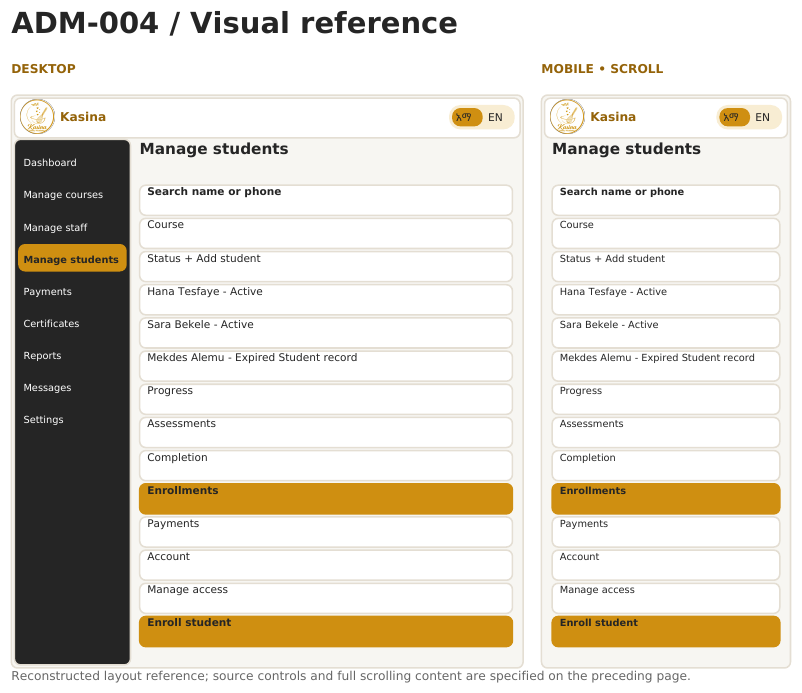

**Behavior and requirements**

Reuse instructor academic views, adding admin-only account, financial and enrollment controls. One identity can have multiple course records. Access status and completion independent; renewal preserves progress. Complimentary enrollment and correction actions should be audited.

**Desktop layout and controls**

Payments Certificates Reports Messages Settings Manage students Search name or phone / Course / Status + Add student / Hana Tesfaye - Active / Sara Bekele - Active / Mekdes Alemu - Expired Student record / Progress / Assessments / Completion / Enrollments / Payments / Account / Manage access / Enroll student

**Mobile / PWA layout and controls**

Search name or phone / Course / Status + Add student / Hana Tesfaye - Active / Sara Bekele - Active / Mekdes Alemu - Expired Student record / Progress / Assessments / Completion / Enrollments / Payments / Account / Manage access / Enroll student

### ADM-005 — Enrollment management

Source: KPA-04 v1.1 pages 81–82. Visual reference: 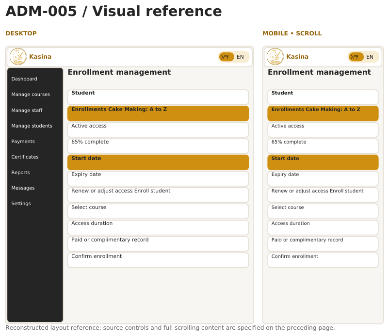

**Behavior and requirements**

Admin enrollment actions must not silently create confirmed payments. Preserve historical access and payment records. Prevent duplicate active enrollment. Renew from the later of current expiry or confirmation date; audit adjustments.

**Desktop layout and controls**

Student / Enrollments Cake Making: A to Z / Active access / 65% complete / Start date / Expiry date / Renew or adjust access Enroll student / Select course / Access duration / Paid or complimentary record / Confirm enrollment

**Mobile / PWA layout and controls**

Student / Enrollments Cake Making: A to Z / Active access / 65% complete / Start date / Expiry date / Renew or adjust access Enroll student / Select course / Access duration / Paid or complimentary record / Confirm enrollment

### ADM-006 — Payments

Source: KPA-04 v1.1 pages 83–84. Visual reference: 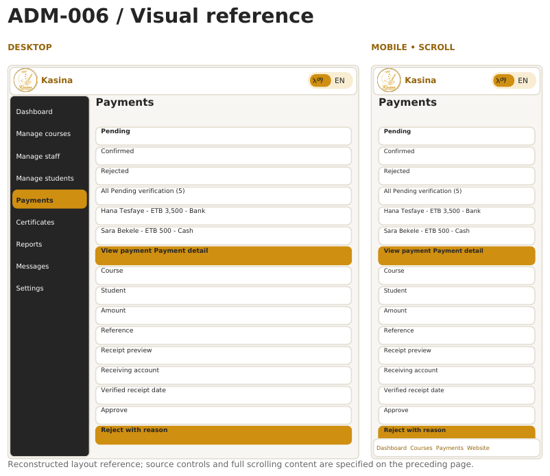

**Behavior and requirements**

Verify against actual bank statement or cash receipt. Approval activates access atomically; rejection records reason and notifies student. Prevent duplicate references and concurrent approval. Authorized admin may record and confirm cash; corrections and refunds use separate audited records. Historical payment dates and account attribution retained.

**Desktop layout and controls**

Certificates Reports Messages Settings Payments Pending / Confirmed / Rejected / All Pending verification (5) / Hana Tesfaye - ETB 3,500 - Bank / Sara Bekele - ETB 500 - Cash / View payment Payment detail / Course / Student / Amount / Reference / Receipt preview / Receiving account / Verified receipt date / Approve / Reject with reason

**Mobile / PWA layout and controls**

Pending / Confirmed / Rejected / All Pending verification (5) / Hana Tesfaye - ETB 3,500 - Bank / Sara Bekele - ETB 500 - Cash / View payment Payment detail / Course / Student / Amount / Reference / Receipt preview / Receiving account / Verified receipt date / Approve / Reject with reason

### ADM-007 — Certificates

Source: KPA-04 v1.1 pages 85–86. Visual reference: 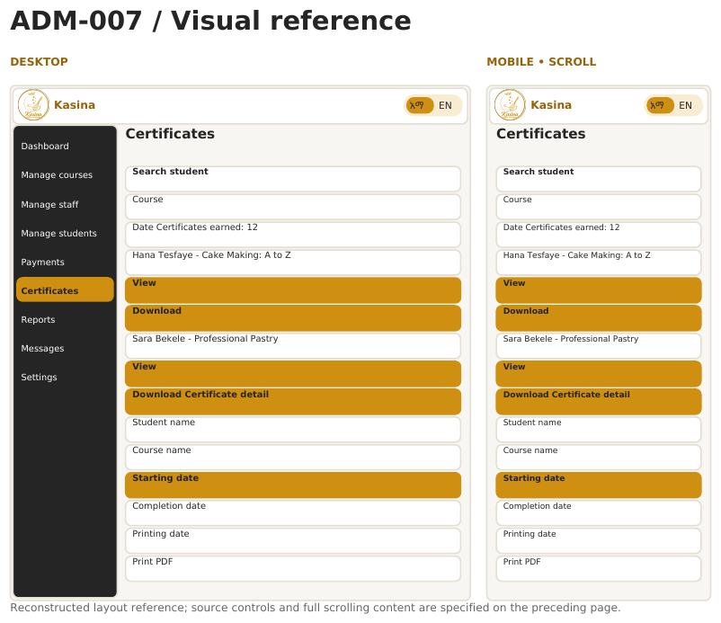

**Behavior and requirements**

Only Certificate Courses generate certificates automatically after required activities pass. Short Courses do not. Admin can inspect and correct authorized records; no routine manual approval. Basic printable completion proof, not automatic national qualification. Official artwork and legal wording pending. Audited identity correction and exceptional invalidation for verified error or fraud supported; authorization policy requires approval.

**Desktop layout and controls**

Reports Messages Settings Certificates Search student / Course / Date Certificates earned: 12 / Hana Tesfaye - Cake Making: A to Z / View / Download / Sara Bekele - Professional Pastry / View / Download Certificate detail / Student name / Course name / Starting date / Completion date / Printing date / Print PDF

**Mobile / PWA layout and controls**

Search student / Course / Date Certificates earned: 12 / Hana Tesfaye - Cake Making: A to Z / View / Download / Sara Bekele - Professional Pastry / View / Download Certificate detail / Student name / Course name / Starting date / Completion date / Printing date / Print PDF

### ADM-008 — Financial reports

Source: KPA-04 v1.1 pages 87–88. Visual reference: 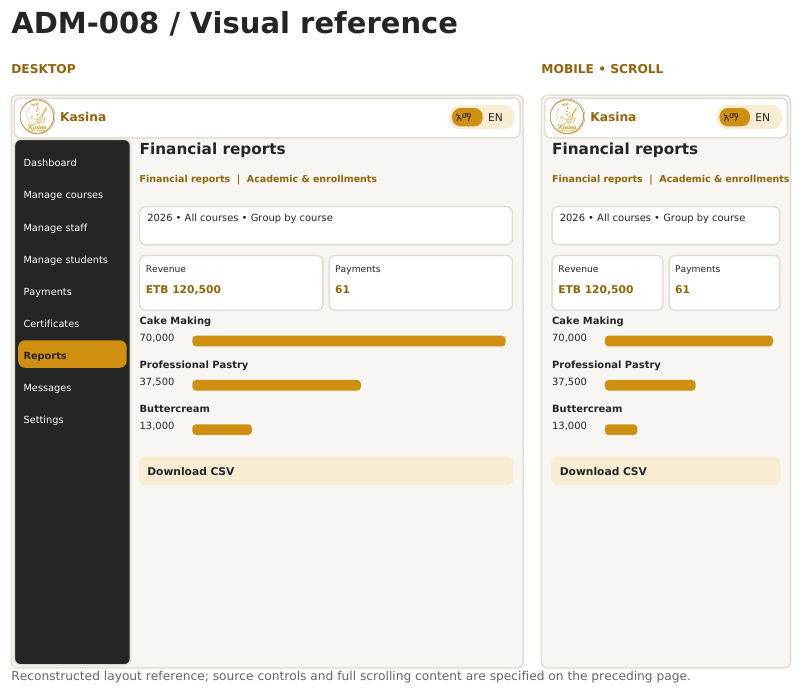

**Behavior and requirements**

Two report tabs only; separate payment breakdown removed. Group by month, course, month and course, method or purpose. Chart, totals and table follow filters; mobile cards replace wide tables. Confirmed receipts attributed to verified receipt date; enrollment attributed to activation date. Renewals count as collections, not new enrollments. Pending/rejected excluded. Revenue is confirmed valid payments only; no accounting reports. Revenue is the sum of valid confirmed payments; no gross/net or accounting interface.

**Desktop layout and controls**

Financial reports / Academic & enrollments Filters / Year / Month / Custom date range / Course / Type / Method / Account / Purpose / Group by: Course Confirmed collections: ETB 120,500 / Confirmed payments: 61 / Cake Making: ETB 70,000 / Professional Pastry: ETB 37,500 / Buttercream: ETB 13,000 / Download CSV

**Mobile / PWA layout and controls**

Financial reports / Academic & enrollments Filters / Year / Month / Custom date range / Course / Type / Method / Account / Purpose / Group by: Course Confirmed collections: ETB 120,500 / Confirmed payments: 61 / Cake Making: ETB 70,000 / Professional Pastry: ETB 37,500 / Buttercream: ETB 13,000 / Download CSV

### ADM-009 — Academic & enrollment reports

Source: KPA-04 v1.1 pages 89–90. Visual reference: 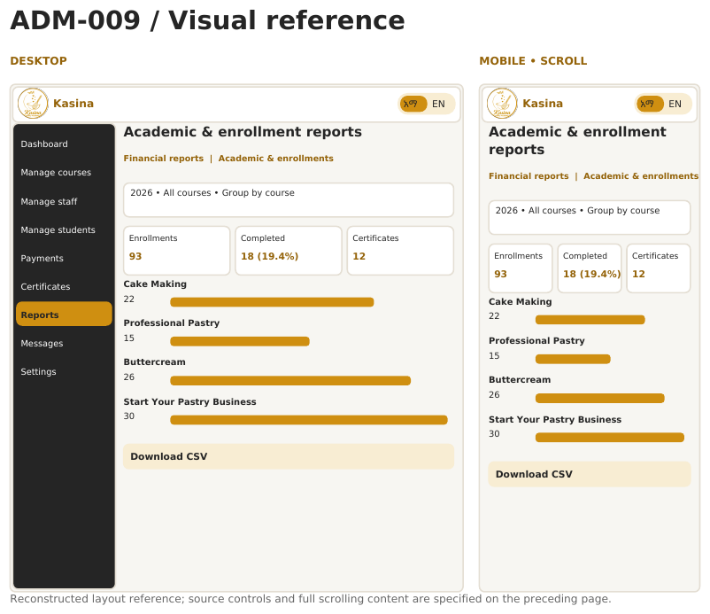

**Behavior and requirements**

Same report components and filtered CSV export. Distinguish unique students, enrollments, renewals, paid/free/complimentary, active/expired access and completion. Completion rate uses same enrollment cohort for numerator and denominator. Quiz/practical metrics and pending review from existing academic records. Use Addis Ababa Gregorian dates; cohort by first activation, status as of report generation. Count distinct students, enrollment records, passed required quizzes/practicals and pending attempts separately. Renewals count access extensions confirmed during the selected period, separately from first-activation cohort. Completion rate = completed cohort enrollments / cohort enrollments; show dash for zero denominator. Pending reviews count pending attempts as of report generation.

**Desktop layout and controls**

Financial reports / Academic & enrollments Filters / Enrollment period / Course / Type / Group by: Course New enrollments: 93 / Active: 65 / Expired: 28 / Completed: 18 / Completion rate: 19.4% / Certificates: 12 Course breakdown / Cake Making: 22 enrolled / 8 completed / Professional Pastry: 15 / 4 / Buttercream: 26 / 6 / Download CSV Start Your Pastry Business: 30 enrolled / 0 completed

**Mobile / PWA layout and controls**

Kasina አማ EN Academic & enrollment reports Financial reports / Academic & enrollments Filters / Enrollment period / Course / Type / Group by: Course New enrollments: 93 / Active: 65 / Expired: 28 / Completed: 18 / Completion rate: 19.4% / Certificates: 12 Course breakdown / Cake Making: 22 enrolled / 8 completed / Professional Pastry: 15 / 4 / Buttercream: 26 / 6 / Download CSV

### ADM-010 — Messages inbox

Source: KPA-04 v1.1 pages 91–92. Visual reference: 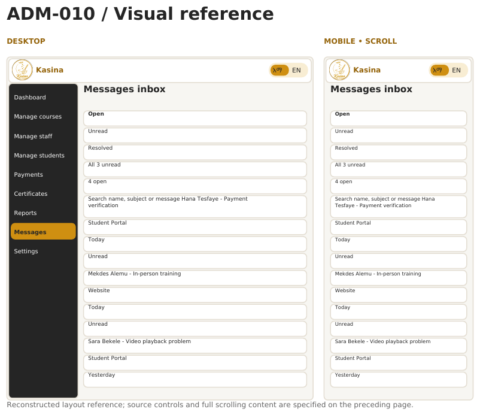

**Behavior and requirements**

Shared admin inbox, search and filters. Read/unread independent of open/resolved. Desktop list left and conversation right; mobile separate detail. No instructor access. Public inquiries and two-way student conversations included; no live chat, ticket routing, attachments or social integrations.

**Desktop layout and controls**

Open / Unread / Resolved / All 3 unread / 4 open / Search name, subject or message Hana Tesfaye Payment verification / Student Portal / Today / Unread / Mekdes Alemu - In-person training / Website / Today / Unread / Sara Bekele - Video playback problem / Student Portal / Yesterday

**Mobile / PWA layout and controls**

Open / Unread / Resolved / All 3 unread / 4 open / Search name, subject or message Hana Tesfaye Payment verification / Student Portal / Today / Unread / Mekdes Alemu - In-person training / Website / Today / Unread / Sara Bekele - Video playback problem / Student Portal / Yesterday

### ADM-011 — Message conversation

Source: KPA-04 v1.1 pages 93–94. Visual reference: 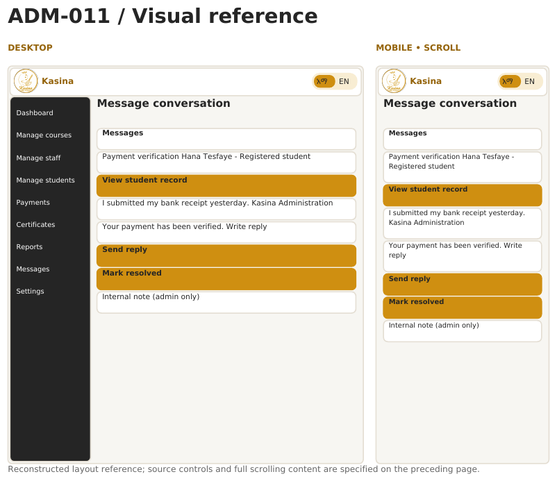

**Behavior and requirements**

Replies record administrator identity; students see Kasina Administration. Student reply reopens resolved conversation. Existing notification bell alerts student. Public visitor replies via configured email or external phone/message; record internal note. No public account required.

**Desktop layout and controls**

Messages / Payment verification Hana Tesfaye - Registered student / View student record / I submitted my bank receipt yesterday. Kasina Administration / Your payment has been verified. Write reply / Send reply / Mark resolved / Internal note (admin only)

**Mobile / PWA layout and controls**

Messages / Payment verification Hana Tesfaye - Registered student / View student record / I submitted my bank receipt yesterday. Kasina Administration / Your payment has been verified. Write reply / Send reply / Mark resolved / Internal note (admin only)

### ADM-012 — Contact Kasina

Source: KPA-04 v1.1 pages 95–96. Visual reference: 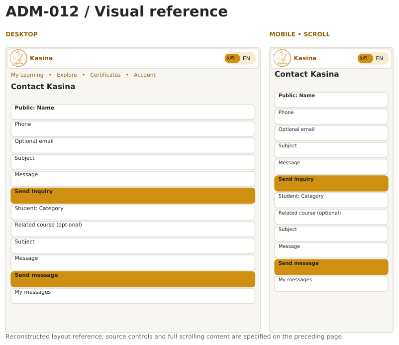

**Behavior and requirements**

Public form in About contact section included. Student Account > Contact Kasina includes conversation history and replies; no new main navigation. Spam protection, rate limits and private authorization required. Telegram student inquiries use same inbox in Phase 2. Public email delivery depends on configuration.

**Desktop layout and controls**

Public inquiry / Name / Phone / Optional email / Subject / Message / Send inquiry Student inquiry / Identity prefilled / Category / Optional related course / Subject / Message / Send message / My messages

**Mobile / PWA layout and controls**

Public website / Student Account Public inquiry / Name / Phone / Optional email / Subject / Message / Send inquiry Student inquiry / Identity prefilled / Category / Optional related course / Subject / Message / Send message / My messages

### ADM-013 — Settings home

Source: KPA-04 v1.1 pages 97–98. Visual reference: 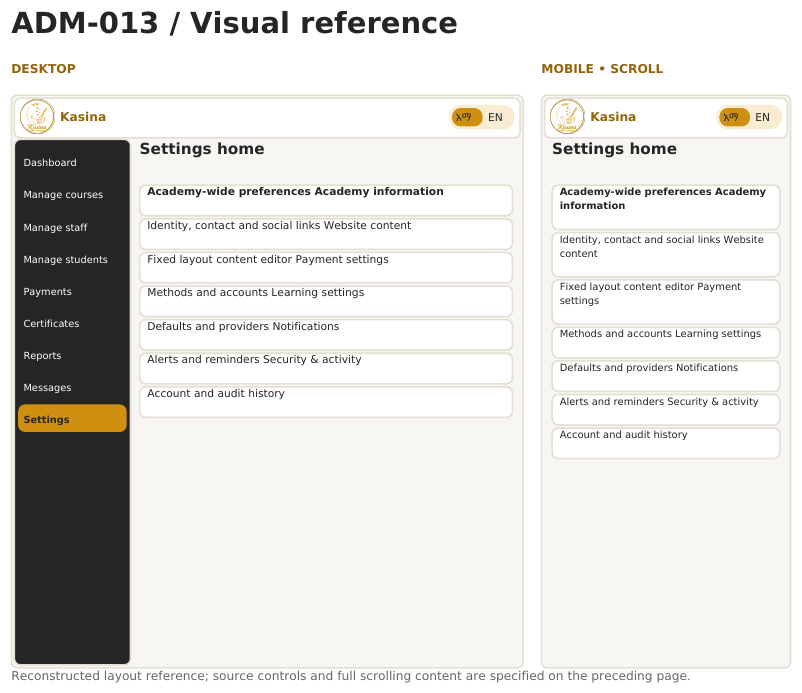

**Behavior and requirements**

Six sections included; no website builder or infrastructure panel. Mobile vertical list, focused editor without bottom navigation. Validate, save, confirm and warn on unsaved changes.

**Desktop layout and controls**

Academy-wide preferences Academy information / Identity, contact and social links Website content / Fixed layout content editor Payment settings / Methods and accounts Learning settings / Defaults and providers Notifications / Alerts and reminders Security & activity / Account and audit history

**Mobile / PWA layout and controls**

Academy-wide preferences Academy information / Identity, contact and social links Website content / Fixed layout content editor Payment settings / Methods and accounts Learning settings / Defaults and providers Notifications / Alerts and reminders Security & activity / Account and audit history

### ADM-014 — Academy information

Source: KPA-04 v1.1 pages 99–100. Visual reference: 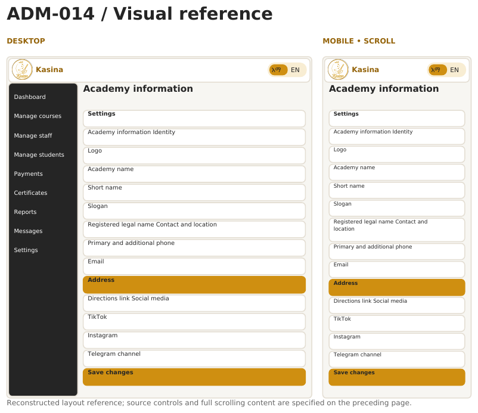

**Behavior and requirements**

Single source for contact and identity across website, student support and payment instructions. Social links prominent on homepage and About, not footer. Actual legal name and official links pending.

**Desktop layout and controls**

Settings / Academy information Identity / Logo / Academy name / Short name / Slogan / Registered legal name Contact and location / Primary and additional phone / Email / Address / Directions link Social media / TikTok / Instagram / Telegram channel / Save changes

**Mobile / PWA layout and controls**

Settings / Academy information Identity / Logo / Academy name / Short name / Slogan / Registered legal name Contact and location / Primary and additional phone / Email / Address / Directions link Social media / TikTok / Instagram / Telegram channel / Save changes

### ADM-015 — Website content

Source: KPA-04 v1.1 pages 101–102. Visual reference: 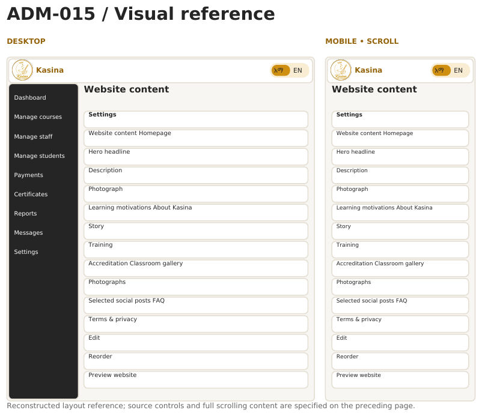

**Behavior and requirements**

Structured bilingual fields, fixed layouts. Course cards from Manage courses, instructor bios from staff profiles, contacts from Academy information. No duplicate editors. Preview before save; accreditation wording and legal terms require confirmation.

**Desktop layout and controls**

Settings / Website content Homepage / Hero headline / Description / Photograph / Learning motivations About Kasina / Story / Training / Accreditation Classroom gallery / Photographs / Selected social posts FAQ / Terms & privacy / Edit / Reorder / Preview website

**Mobile / PWA layout and controls**

Settings / Website content Homepage / Hero headline / Description / Photograph / Learning motivations About Kasina / Story / Training / Accreditation Classroom gallery / Photographs / Selected social posts FAQ / Terms & privacy / Edit / Reorder / Preview website

### ADM-016 — Homepage content editor

Source: KPA-04 v1.1 pages 103–104. Visual reference: 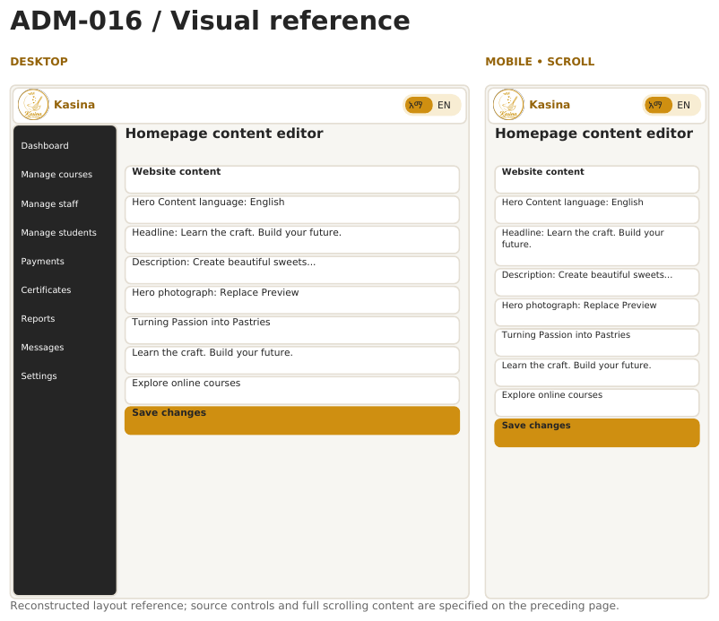

**Behavior and requirements**

Content language separate from interface language. Preserve unsaved edits during language switch. Fixed design, editable copy and imagery.

**Desktop layout and controls**

Website content / Hero Content language: English / Headline: Learn the craft. Build your future. / Description: Create beautiful sweets... / Hero photograph: Replace Preview / Turning Passion into Pastries / Learn the craft. Build your future. / Explore online courses / Save changes

**Mobile / PWA layout and controls**

Website content / Hero Content language: English / Headline: Learn the craft. Build your future. / Description: Create beautiful sweets... / Hero photograph: Replace Preview / Turning Passion into Pastries / Learn the craft. Build your future. / Explore online courses / Save changes

### ADM-017 — Payment settings

Source: KPA-04 v1.1 pages 105–106. Visual reference: 

**Behavior and requirements**

Require at least one enabled method for paid enrollment. Bank-account changes require a fresh SMS OTP (step-up), are audited, and send an SMS and in-app alert to the administrator's verified phone; no second administrator is required [v1.2: D-03, D-04]. Deactivation preserves historical payments. Actual bank accounts and gateway configuration pending.

**Desktop layout and controls**

Settings / Payment settings Payment methods / Bank transfer: Enabled / Cash: Enabled / Online: Not configured Receiving accounts / Add account / Edit / Deactivate / Bank / Account holder / Account number Instructions / Bank transfer / Cash instructions / Save changes

**Mobile / PWA layout and controls**

Settings / Payment settings Payment methods / Bank transfer: Enabled / Cash: Enabled / Online: Not configured Receiving accounts / Add account / Edit / Deactivate / Bank / Account holder / Account number Instructions / Bank transfer / Cash instructions / Save changes

### ADM-018 — Learning settings

Source: KPA-04 v1.1 pages 107–108. Visual reference: 

**Behavior and requirements**

Defaults apply to new records, not retroactively. Course and quiz overrides remain in shared editors. Disable provider for new uploads without interrupting existing lessons. Upload limits, retention and provider policy pending testing. Fixed Certificate and Short course types.

**Desktop layout and controls**

Settings / Learning settings Course defaults / Access duration: 90 days / Quiz pass mark: 80% Video providers / Bunny Stream / YouTube / Kasina server Practical submission limits / Duration: 3 minutes (example) / Upload size: 100 MB (example) / Save changes

**Mobile / PWA layout and controls**

Settings / Learning settings Course defaults / Access duration: 90 days / Quiz pass mark: 80% Video providers / Bunny Stream / YouTube / Kasina server Practical submission limits / Duration: 3 minutes (example) / Upload size: 100 MB (example) / Save changes

### ADM-019 — Notifications

Source: KPA-04 v1.1 pages 109–110. Visual reference: 

**Behavior and requirements**

Essential in-app notices remain enabled; SMS optional by event. Login verification separate. Telegram can add a channel later. Defaults and service configuration proposed.

**Desktop layout and controls**

Settings / Notifications Event / In-app / SMS / Payment confirmed: Yes / Yes / Payment rejected: Yes / Yes / Access expiring: Yes / Yes / Assessment reviewed: Yes / No / Certificate earned: Yes / No / Announcement: Yes / No / Admin reply: Yes / No Reminders / 7 days / 1 day / Expiry / SMS service / Telegram Phase 2 / Save changes

**Mobile / PWA layout and controls**

Settings / Notifications Event / In-app / SMS / Payment confirmed: Yes / Yes / Payment rejected: Yes / Yes / Access expiring: Yes / Yes / Assessment reviewed: Yes / No / Certificate earned: Yes / No / Announcement: Yes / No / Admin reply: Yes / No Reminders / 7 days / 1 day / Expiry / SMS service / Telegram Phase 2 / Save changes

### ADM-020 — Security & activity

Source: KPA-04 v1.1 pages 111–112. Visual reference: 

**Behavior and requirements**

Reuse shared account security. Audit important admin and instructor actions, actor, time and change details. No editing or deleting individual audit entries. Sensitive credentials remain in secure deployment configuration.

**Desktop layout and controls**

My account / Activity log Filter actor / Activity / Date / Export CSV Payment confirmed - Administrator 1 / Course price changed - Administrator 2 / Instructor assigned - Administrator 1 / Bank account updated Administrator 2 My account / Personal information / Active sessions / Sign out other devices [v1.2: 'Additional authentication' removed, D-04]

**Mobile / PWA layout and controls**

My account / Activity log Filter actor / Activity / Date / Export CSV Payment confirmed - Administrator 1 / Course price changed - Administrator 2 / Instructor assigned - Administrator 1 / Bank account updated Administrator 2 My account / Personal information / Active sessions / Sign out other devices [v1.2: 'Additional authentication' removed, D-04]

## Telegram (Phase 2)

### TG-001 — Learn at Kasina — Telegram

Source: KPA-04 v1.1 pages 113–114. Visual reference: 

**Behavior and requirements**

Complete Student Portal reused, not a separate subset or separate application. Even admin/instructor using Telegram sees student only. Shared UI components, translations, academic records, payment/enrollment, uploads, progress, certificates and notifications. Phase 1 prepare self-contained student navigation, provider abstraction, mobile uploads, server-side progress, identity linking, deep links. Phase 2 verified Telegram authentication/linking, container, bot notifications, compatible payment integration, file/video/download/navigation testing. Public Telegram channel marketing; bot personal notifications; Mini App learning. Account linking section hidden until phase 2. Phase 2 only; same full Student Portal. Verify Telegram identity linking, digital goods payment rules and file/video compatibility before launch.

**Validation / configuration (open, do not invent):** Telegram digital goods payment rules, identity linking and file compatibility require validation; no separate Telegram implementation promised.

**Desktop layout and controls**

One platform / one identity / one database Public website + Student + Instructor + Admin on web/PWA Student Portal also distributed in Telegram Phase 2

**Mobile / PWA layout and controls**

Kasina አማ EN Learn at Kasina — Telegram Learn at Kasina My Learning · Explore · Certificates · Account Same student pages and records No public marketing or management portals

## Release gates

Confirm the legal company name, official contacts, social links, bank accounts, logo and image rights, course data, accreditation claims, certificate artwork, terms, privacy and refund policy.

The following must be validated:
- native Amharic review
- low-end Android testing
- video upload limits and retention
- SMS and email configuration
- the administrator account recovery procedure (operator runbook) [v1.2: replaces "MFA recovery", D-04]
- backup restore
- accessibility

Telegram payment and linking rules are Phase 2 gates. KPA-04 is the master product specification. KPA-01, KPA-02 and FRONTEND_BRIEF.md follow its screen IDs and rules. KPA-03 is intentionally excluded.

Visual fidelity limitation: the screen diagrams were reconstructed from the prior PDF and structured source descriptions. They do not reproduce all original photographs or interactive mockups. Use them as visual references only, not as a requirements authority.

Do not launch until these pass:
- provider playback
- private uploads
- the account recovery procedure [v1.2: replaces "MFA recovery", D-04]
- payment reconciliation
- backup restoration
- localization
- accessibility
- actual-device pilot tests

No application testing has been performed on the design itself.

## Localized reference — draft Amharic

Native review required before release.

| Amharic (draft) | English |
| --- | --- |
| የእኔ ትምህርቶች | My Learning |
| የኬክ አሰራር | Cake Making |
| ተጠናቋል | completed (shown with a percentage, e.g. 65% completed) |
| ትምህርቱን ይቀጥሉ | Continue learning |
